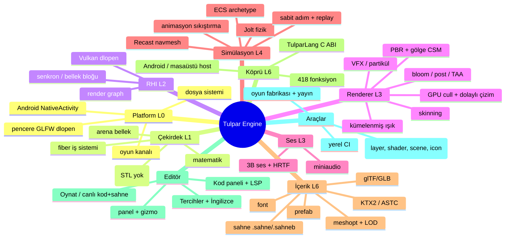

<!-- ÜRETİLDİ: tools/ozellik_haritasi.py — elle düzenleme; `python3 tools/ozellik_haritasi.py` ile yenile. -->
# Tulpar Engine — Özellik Haritası

Bu sayfa motorun **bütün özelliklerinin** aranabilir haritasıdır: bir şey nerede, hangi köprü fonksiyonu, hangi editör komutu, hangi test, hangi belge. Kaynaktan üretilir (eskirse `tools/ozellik_haritasi.py --denetle` kırmızı döner). Hızlı arama: `python3 tools/ozellik_haritasi.py --ara <kelime>` ya da bu dosyada grep.

**Sayılar:** köprü 418 fonksiyon · 795 `ENGINE_TEST` · ~32 editör komutu.

## 0. Zihin haritası (üst düzey)

## 1. Katmanlar ve dosyalar

Her satır: `dosya` — ilk başlık yorumu. Katman kuralı: bir katman yalnız altındakini `#include` eder (`tools/layer_check.py`).

### platform — L0 (39 dosya, 5040 satır)

- `platform/crash.cpp` — PLATFORM NOTU: mingw-w64 `unistd.h`, `fcntl.h`, `dirent.h` ve GCC de
- `platform/crash.hpp` — crash reporter (plan Faz 0, EK C.1.4). Native motorda sahadan
- `platform/dl.hpp` — dinamik kutuphane yukleme (dlopen / LoadLibrary).
- `platform/dosya_secici.cpp` — isletim sisteminin dosya / klasor secicisi (dosya_secici.hpp).
- `platform/dosya_secici.hpp` — isletim sisteminin dosya / klasor secicisi (docs/EDITOR-UYGULAMA-PLANI.md U4).
- `platform/fatal.cpp` — 
- `platform/fatal.hpp` — olumcul hata ve iddia. Motorda exception YOK (Tasarim Aksiyomu
- `platform/frame_pacer.hpp` — Kare hizi ayarlama (500 madde listesi #200/#464 "Frame
- `platform/fs.hpp` — dosya sistemi farklari (yalniz gercekten AYRISAN kisim).
- `platform/fs_ops.cpp` — if defined(_WIN32)
- `platform/fs_ops.hpp` — dosya/dizin ISLEMLERI (yarat, sil, tasi, gez, oku).
- `platform/game_channel.cpp` — if defined(_WIN32)
- `platform/game_channel.hpp` — GOMULU OYUN KANALI: editorun F5'i oyunu AYRI BIR SURECTE
- `platform/gesture.cpp` — 
- `platform/gesture.hpp` — Jest tanima: platform/touch.hpp'nin HAM cok-parmakli durumu
- `platform/http.cpp` — engelleyen HTTP/1.1 istemcisi. Sozlesme: platform/http.hpp.
- `platform/http.hpp` — engelleyen HTTP/1.1 istemcisi (TCP, POSIX + Winsock). WoE M1a (2026-11-08).
- `platform/memory.cpp` — L0 — ham sanal bellek. POSIX'te mmap/munmap/mprotect, Windows'ta
- `platform/memory.hpp` — isletim sisteminden bellek. YALNIZ acilista cagrilir
- `platform/net.cpp` — if defined(_WIN32)
- `platform/net.hpp` — yerel ag: engellemesiz UDP/IPv4 soketi (POSIX + Winsock).
- `platform/paths.cpp` — if defined(_WIN32)
- `platform/paths.hpp` — CALISAN IKILININ dizini + varlik yolu cozumleme.
- `platform/perf_hint.cpp` — if defined(__ANDROID__)
- `platform/perf_hint.hpp` — ADPF Performance Hint API (420 madde listesi #176/#353:
- `platform/process.cpp` — if defined(_WIN32)
- `platform/process.hpp` — alt surec baslatma (editorun "Dis editorde ac" ve "Oynat"i).
- `platform/startup_report.cpp` — 
- `platform/startup_report.hpp` — BASLATMA hatasini kullanicinin GOREBILECEGI bir yere yazar.
- `platform/thermal.cpp` — if defined(__ANDROID__)
- `platform/thermal.hpp` — ADPF Termal API (420 madde listesi #13/#174-176/#351-353:
- `platform/thread.cpp` — MinGW-w64 winpthreads'i tasidigi icin thread/mutex/sched yolu Windows'ta da
- `platform/thread.hpp` — is parcacigi ilkelleri. Job sistemi (L1) bunun ustune kurulu;
- `platform/time.cpp` — 
- `platform/time.hpp` — monoton saat. Profiler ve kare zamanlamasi buradan okur.
- `platform/touch.hpp` — dokunmatik durum: host (Android olay kuyrugu / masaustu fare)
- `platform/window.cpp` — if !defined(__ANDROID__)
- `platform/window.hpp` — masaustu gelistirme penceresi (GLFW, dlopen). Uretim hedefi
- `platform/android/jni_bridge.cpp` — L0 PLATFORM (Android) — Kotlin host <-> motor JNI koprusu (plan Faz 1,

### core — L1 (40 dosya, 4144 satır)

- `core/build_info.cpp` — build_info.hpp'nin uygulamasi. TULPAR_SURUM yalniz BU dosyaya
- `core/build_info.hpp` — ikilinin KIMLIGI: hangi surumden ve hangi platform icin derlendi.
- `core/event.cpp` — 
- `core/event.hpp` — Sifir Tahsisli Event Bus (Olay Yolu).
- `core/containers/array.hpp` — Array<T>: sabit kapasiteli dizi. Kapasite init'te ARENADAN
- `core/containers/hash_map.hpp` — HashMap<K,V>: acik adresleme (dogrusal sondalama), sabit
- `core/containers/span.hpp` — Span<T>: sahipsiz, bitisik gorunum. STL yok (plan L1).
- `core/containers/static_string.hpp` — StaticString<N>: sabit tamponlu, NUL sonlu dizgi. Ayirma yok;
- `core/crypto/sha256.cpp` — 
- `core/crypto/sha256.hpp` — SHA-256 (FIPS 180-4). Akis API'si (init/update/final) + tek cagri.
- `core/jobs/fiber.cpp` — 
- `core/jobs/fiber.hpp` — Fiber: kendi yigini olan, ISBIRLIKLI olarak degistirilen yurutme
- `core/jobs/fiber_switch_aarch64.S` — AArch64 AAPCS64 fiber gecisi. Callee-saved: x19-x28, x29(fp), x30(lr),
- `core/jobs/fiber_switch_x86_64.S` — x86_64 fiber gecisi — IKI ABI.
- `core/jobs/job_graph.cpp` — 
- `core/jobs/job_graph.hpp` — Statik is bagimlilik grafigi (500 madde listesi #181 "Job
- `core/jobs/job_system.cpp` — if ENGINE_TRACY
- `core/jobs/job_system.hpp` — Fiber tabanli job sistemi (Naughty Dog, GDC 2015 modeli).
- `core/jobs/spinlock.hpp` — kisa kritik bolgeler icin spinlock. Mutex YOK (plan L1):
- `core/math/bvh.cpp` — 
- `core/math/bvh.hpp` — Ikili sinirlayici hacim hiyerarsisi (Bounding Volume Hierarchy).
- `core/math/fixed.hpp` — Sabit noktali (fixed-point) deterministik aritmetik: Q16.16.
- `core/math/nn.cpp` — 
- `core/math/nn.hpp` — Kucuk ileri-beslemeli sinir agi cikarimi (500 madde listesi
- `core/math/noise.hpp` — Deterministik deger gurultusu (value noise) + fraktal Brownian
- `core/math/random.hpp` — Deterministik PRNG (500 madde listesi #438 "PCG (Prosedurel
- `core/math/spatial_hash.cpp` — 
- `core/math/spatial_hash.hpp` — Uzamsal hash izgarasi: "su noktanin R yaricapindaki her sey
- `core/math/vec.hpp` — vektor/matris/quaternion. float, sutun-major mat4, sag el.
- `core/memory/alloc_gate.cpp` — 
- `core/memory/alloc_gate.hpp` — A2 kapisi: "kare icinde allocation YOKTUR" iddiasini OLCER.
- `core/memory/alloc_gate_override.cpp` — Global operator new/delete override — YURUTULEBILIRE acikca eklenir
- `core/memory/arena.cpp` — 
- `core/memory/arena.hpp` — Arena (dogrusal ayirici). Tasarim Aksiyomu A2: kare icinde
- `core/memory/ebr.cpp` — 
- `core/memory/ebr.hpp` — Epoch-Based Reclamation (EBR)
- `core/memory/pool.hpp` — Pool<T>: sabit boyutlu, serbest listeli, NESIL ETIKETLI slotmap.
- `core/profiler/profiler.cpp` — if ENGINE_TRACY
- `core/profiler/profiler.hpp` — Profiler (Faz 0'da yazilir, sonra degil: "olcemedigin seyi
- `core/reflect/reflect.hpp` — Core reflection interface placeholder - see content/reflect.hpp for SceneEntity reflection

### rhi — L2 (15 dosya, 3883 satır)

- `rhi/command_pools.cpp` — 
- `rhi/command_pools.hpp` — thread basina komut havuzu (plan L2: "command buffer'lar paralel
- `rhi/device.cpp` — 
- `rhi/device.hpp` — Device: instance + fiziksel cihaz secimi + mantiksal cihaz +
- `rhi/frame_graph.cpp` — 
- `rhi/frame_graph.hpp` — Frame Graph: pass/kaynak bagimlilik grafigi, BUDAMA (kullanilmayan
- `rhi/offscreen.cpp` — 
- `rhi/offscreen.hpp` — Faz 1 "ilk piksel": pencere ACMADAN, subpass zincirli (depth
- `rhi/pipeline_cache.hpp` — Kalici boru hatti (PSO) onbellegi + on isinma/kurulum olcumu.
- `rhi/swapchain.cpp` — 
- `rhi/swapchain.hpp` — Swapchain + kare senkronu (masaustu pencere; Android yuzeyi de
- `rhi/tile_budget.cpp` — 
- `rhi/tile_budget.hpp` — Tulpar Engine — L2 RHI: Mali tile butcesi (tasarim kisiti, kodla zorlanir).
- `rhi/vk_api.cpp` — 
- `rhi/vk_api.hpp` — Vulkan yukleyici. Loader (libvulkan) DLOPEN ile: link zamani

### renderer — L3 (24 dosya, 7795 satır)

- `renderer/cluster.cpp` — 
- `renderer/cluster.hpp` — kumelenmis (clustered) isik atamasi, CPU tarafinda.
- `renderer/cluster_cull.cpp` — 
- `renderer/cluster_cull.hpp` — GPU-driven kume elemesinin CPU TARAFI: shader'a giden veri
- `renderer/cluster_lod.cpp` — 
- `renderer/cluster_lod.hpp` — SUREKLI LOD: gorunume bagli kume secimi (cut).
- `renderer/cull.hpp` — GPU GORUNURLUK KUMELEME (cull) + DOLAYLI (indirect) CIZIM.
- `renderer/debug_draw.cpp` — glampert/debug-draw bu makrolari `#ifndef` ile korur; asagidakiler
- `renderer/debug_draw.hpp` — Hata ayiklama cizimi (tek karelik cizgi/kure/kutu/ok/eksen).
- `renderer/geom_density.hpp` — UCGEN / PIKSEL ORANI olcumu (Faz 9, PLAN REV: "hedef Nanite sinifi
- `renderer/graph.hpp` — DERLENMIS RENDER GRAPH (ilk surum, plan §6).
- `renderer/graph_builder.hpp` — Dinamik Render Graph Derleyicisi (graph_builder.hpp)
- `renderer/indirect_cull.cpp` — 
- `renderer/indirect_cull.hpp` — Instance frustum culling + mesafeye-gore LOD secimi,
- `renderer/lighting_pipeline.cpp` — 
- `renderer/lighting_pipeline.hpp` — Kademeli golge haritalari (CSM) icin CPU tarafi matematik.
- `renderer/meshlet_pipeline.cpp` — 
- `renderer/meshlet_pipeline.hpp` — Meshlet (kume) insasi: GPU-driven cizimin CPU tarafi.
- `renderer/nextgen_render.cpp` — 
- `renderer/nextgen_render.hpp` — Iki BAGIMSIZ, gercekten implemente edilmis parca:
- `renderer/particle_gpu_indirect.hpp` — Bevy Hanabi GPU Indirect, Vulkan DGC & TBDR Mobil Partikul Mimarisi.
- `renderer/renderer.cpp` — 
- `renderer/renderer.hpp` — Faz 3 ilk dilim: forward (Lambert) cizici. Depth prepass ->
- `renderer/wboit_pass.hpp` — WBOIT (Weighted Blended Order-Independent Transparency) & Hareket Vektorleri.

### audio — L3 (12 dosya, 2161 satır)

- `audio/clip.cpp` — 
- `audio/clip.hpp` — klip yukleme: WAV/FLAC/MP3 (miniaudio decoder) -> PCM float Arena'da,
- `audio/device.cpp` — if !defined(_WIN32)
- `audio/device.hpp` — cihaz: miniaudio (vendored, MIT-0) uzerinden platform ses cikisi.
- `audio/dsp.hpp` — ana yol (master bus) DSP zinciri.
- `audio/hrtf.hpp` — HRTF (bas iliskili aktarim islevi) ile 3B ses, 2026-11-04.
- `audio/hrtf_kemar.h` — URETILMIS DOSYA — tools/hrtf_kemar.py (elle duzenleme).
- `audio/miniaudio_impl.c` — miniaudio govdesi (vendored, MIT-0). Yalniz gereken: cihaz + WAV/FLAC/MP3 kod cozme.
- `audio/mixer.cpp` — 
- `audio/mixer.hpp` — karistirici: sabit ses (voice) havuzu, oyun thread'inden kilitsiz
- `audio/particle_audio.hpp` — Fiziksel Partikul Sonifikasyonu (Kinetic Particle Sonification).
- `audio/spatial.hpp` — uzamsal ses: dinleyici bazi, mesafe sonumu, sabit-guc panlama ve

### sim — L4 (53 dosya, 6470 satır)

- `sim/ability_system.cpp` — 
- `sim/ability_system.hpp` — 
- `sim/animation.cpp` — 
- `sim/animation.hpp` — Animasyon: iskelet + sikistirilmis klip + poz degerlendirme.
- `sim/anticheat.cpp` — 
- `sim/anticheat.hpp` — En ucuz hareket-makuliyeti kontrolu (420 madde listesi
- `sim/behavior_tree.cpp` — 
- `sim/behavior_tree.hpp` — Basit davranis agaci (Behavior Tree). DEVAM_PLANI.md
- `sim/boids.cpp` — 
- `sim/boids.hpp` — Suru Davranisi (Boids).
- `sim/camera_rig.cpp` — 
- `sim/camera_rig.hpp` — Kamera sistemi temel taslari (500 madde listesi #168-177
- `sim/chaos_physics.cpp` — 
- `sim/chaos_physics.hpp` — Karakter/kalabalik hareketi icin iki KLASIK, tam
- `sim/desync.cpp` — 
- `sim/desync.hpp` — Desync/rollback yapi tasi (420 madde listesi #5/#391/#399:
- `sim/ecs.cpp` — 
- `sim/ecs.hpp` — Archetype ECS (SoA). Plan §1.5 "ADAPTE": archetype'lar
- `sim/fluid_system.cpp` — 
- `sim/fluid_system.hpp` — SPH (Smoothed Particle Hydrodynamics) akiskan simulasyonu.
- `sim/ik.cpp` — 
- `sim/ik.hpp` — Analitik iki-kemik IK (500 madde listesi #452 "Ters
- `sim/interp.cpp` — 
- `sim/interp.hpp` — Anlik-goruntu (snapshot) enterpolasyonu (420 madde listesi
- `sim/lag_compensation.cpp` — 
- `sim/lag_compensation.hpp` — Lag compensation: sunucu tarafi ISABET testi icin geriye
- `sim/lockstep.cpp` — kilit adimli komut cekirdegi (sim/lockstep.hpp). Davranis kup-kure ag.tpr / duello.tpr
- `sim/lockstep.hpp` — kilit adimli (lockstep) komut cekirdegi, iki koltuk (F6, 2026-11-04).
- `sim/ml_system.cpp` — 
- `sim/ml_system.hpp` — Ogrenilmis (ML) fizik/davranis yaklasiklamasi.
- `sim/mls_mpm.hpp` — 2026 MLS-MPM Cok Fazli Fizik (Moving Least Squares Material Point Method).
- `sim/navmesh.cpp` — 
- `sim/navmesh.hpp` — Navmesh: Recast (bake) + Detour (sorgu) uzerine ince sarmalayici.
- `sim/neo_riemannian.cpp` — 
- `sim/neo_riemannian.hpp` — Neo-Riemannian Muzik Uretici.
- `sim/network_system.hpp` — Rollback (geriye sarma) netcode surucusu.
- `sim/neural_particles.hpp` — 2026 NPA (Neural Particle Automata).
- `sim/npc_motivation.cpp` — 
- `sim/npc_motivation.hpp` — TD-Hatasi NPC Motivasyonu (Dopamin/Ogrenme temelli NPC).
- `sim/physics.cpp` — Jolt: Jolt.h HER ZAMAN ilk (JPH makrolari). Jolt tipleri bu .cpp'nin disina cikmaz.
- `sim/physics.hpp` — Fizik: Jolt (vendored) uzerine ince sarmalayici. Jolt
- `sim/physics_jobs.hpp` — Jolt'un JobSystem arayuzunu BIZIM fiber job sistemimize
- `sim/quantum_gen.cpp` — 
- `sim/quantum_gen.hpp` — Dalga Fonksiyonu Cokusu (Wave Function Collapse, WFC)
- `sim/replay.hpp` — Deterministik girdi kaydi + tekrar oynatma. 500 madde
- `sim/rollback.hpp` — Rollback netcode cekirdegi (500 madde listesi #5/#431:
- `sim/schedule.cpp` — 
- `sim/schedule.hpp` — sistem zamanlayici + sabit adim + kayit/replay.
- `sim/state_machine.cpp` — 
- `sim/state_machine.hpp` — Basit Sonlu Durum Makinesi (Finite State Machine).
- `sim/timers.cpp` — ratas BURADA, .cpp icinde. Global ad alanina `Tick`/`TimerWheel`
- `sim/timers.hpp` — Zamanlayici: "N tick sonra su islevi cagir" (tek atislik
- `sim/voxel_smoke.hpp` — CS2 Tarzi Duyarli Voksel Dumani (Responsive Eulerian-Lagrangian Voxel Smoke).

### content — L6 (57 dosya, 12488 satır)

- `content/clod_format.cpp` — 
- `content/clod_format.hpp` — .clod dosya formati: CEVRIMDISI firinlanmis surekli LOD verisi.
- `content/cluster_dag.hpp` — Kume (cluster) DAG: mesh'i ~64-128 ucgenlik KUMELERE boler,
- `content/device_tier.cpp` — 
- `content/device_tier.hpp` — Cihaz-sinifi profil tablosu (420 madde listesi #6/#395:
- `content/dynamic_quality.cpp` — 
- `content/dynamic_quality.hpp` — Kare-suresi guduml, histerezisli kalite olcekleyici (420
- `content/font.cpp` — 
- `content/font.hpp` — TTF'ten glif atlasi (stb_truetype, yukleme aninda) ve UTF-8
- `content/gi.hpp` — GI SONDA BAKE'i (PLAN Faz 6: "scene compiler: resident set,
- `content/gltf.cpp` — 
- `content/gltf.hpp` — glTF 2.0 yukleyici (cgltf + stb_image, ikisi de yalniz yukleme
- `content/hash.hpp` — Icerik boru hattinin tek ozet fonksiyonu: FNV-1a 64.
- `content/image.cpp` — 
- `content/image.hpp` — arayuz RESMI (PNG/JPG -> RGBA8). stb_image yalniz yukleme aninda
- `content/importer.hpp` — Ice aktarma onbellegi (PLAN Faz 6: "importer + content hash cache").
- `content/ktx2.cpp` — 
- `content/ktx2.hpp` — KTX2 konteyneri (Khronos, kendi okuyucu/yazicimiz: ~200 satir;
- `content/lod_select.cpp` — 
- `content/lod_select.hpp` — Mesafeye gore LOD secimi (500 madde listesi #95 "Traditional
- `content/meshopt.cpp` — 
- `content/meshopt.hpp` — mesh optimizasyonu (meshoptimizer, vendored, MIT). Yukleme
- `content/model.hpp` — bellekteki model: glTF'ten (ya da ileride kendi pack
- `content/morph.cpp` — 
- `content/morph.hpp` — Morph target / blend shape karistirma (500 madde listesi #161
- `content/occlusion.cpp` — 
- `content/occlusion.hpp` — Yazilim tabanli occlusion culling (500 madde listesi #93
- `content/pack.hpp` — Blok adreslenebilir varlik arsivi (.tpak): PLAN Faz 6
- `content/particle_channel.hpp` — Niagara Data Channels & Oynanis/Fizik Cift-Yonlu Etkilesim Koprusu.
- `content/particle_gaussian.hpp` — 3D Gaussian Splatting Partikülleri (PhysGaussian / Anisotropic Gaussians).
- `content/particle_meshlet.hpp` — Particle Meshlet Clustering (Task/Mesh Shader hazirligi).
- `content/particle_module.hpp` — Moduler VFX Boru Hatti ve IParticleModule Bilesen Mimarisi.
- `content/particle_rvt.hpp` — Kalici Enkaz Birikimi (Nanite Tarzi Persistent World Baking & RVT Splatting).
- `content/particles.hpp` — CPU tarafli, sabit-kapasiteli parcacik (particle) sistemi.
- `content/prefab.cpp` — 
- `content/prefab.hpp` — prefab: sahne alt agacini dosyaya al, baska sahneye ornekle.
- `content/primitives.cpp` — 
- `content/primitives.hpp` — prosedurel ilkel geometri tablosu.
- `content/reflect.hpp` — TulparEngine Statik Yansıma ve Bileşen Metaveri Sistemi (reflect.hpp)
- `content/ribbon.hpp` — Dynamic Ribbon Trail geometry generation.
- `content/scene.cpp` — 
- `content/scene.hpp` — Sahne veri modeli + deterministik metin format (.sahne) +
- `content/scene_blob.cpp` — 
- `content/scene_blob.hpp` — Derlenmis sahne (.sahneb): PLAN §6 "sahne bir blob + kod".
- `content/scene_compile.hpp` — Sahne DERLEYICISI (PLAN Faz 6: "scene compiler: resident set,
- `content/scene_runtime.cpp` — 
- `content/scene_runtime.hpp` — Derlenmis sahnenin (SceneBlobView) runtime tuketicisi:
- `content/terrain.cpp` — 
- `content/terrain.hpp` — Prosedurel terrain: yukseklik haritasi uretimi + orneklemesi
- `content/vendored_impl.c` — Uçüncü parti yükleyicilerin tek TU'daki gövdeleri (C, uyarılar kapalı:
- `content/vfx_graph.hpp` — Cift-Yonlu Dugum Grafi Mimarisi (Node-Based VFX Graph).
- `content/voxel.cpp` — 
- `content/voxel.hpp` — Voksel teknolojisi (500 madde listesi #453 "Voxel
- `content/water_wave.cpp` — 
- `content/water_wave.hpp` — Gerstner dalgalari (500 madde listesi #137 "Gerstner
- `content/wind.cpp` — 
- `content/wind.hpp` — Prosedurel ruzgar alani (500 madde listesi #472 "Wind

### app — L6 (73 dosya, 35744 satır)

- `app/android_main.cpp` — Android NativeActivity host (native_app_glue). Iki kip, sistem
- `app/baslatici_win.cpp` — Windows baslaticisi "Tulpar Editor.exe" (docs/EDITOR-UYGULAMA-PLANI.md U7b).
- `app/demo.cpp` — engine_demo (masaustu): GLFW penceresi ya da --headless N --out x.ppm.
- `app/demo_app.cpp` — 
- `app/demo_app.hpp` — demo uygulamasi: host'tan bagimsiz cekirdek. Host (masaustu GLFW,
- `app/demo_scene.cpp` — 
- `app/demo_scene.hpp` — Faz 2 entegre sahnesi, pencereli/headless demo icin: navmesh
- `app/editor.cpp` — engine_editor — masaustu editor (GLFW dlopen pencere) ya da headless.
- `app/editor_app.cpp` — if defined(_WIN32)
- `app/editor_app.hpp` — Editor: motorun kendisi masaustunde duzenleme kipinde (PLAN L7:
- `app/editor_betik.cpp` — 
- `app/editor_betik.hpp` — Betikler herkes icin (docs/EDITOR-UYGULAMA-PLANI.md U10).
- `app/editor_camera.cpp` — 
- `app/editor_camera.hpp` — Editor GORUNUM KAMERASI: gezinme artik bir SAF FONKSIYON.
- `app/editor_chrome.cpp` — Editor cercevesi: menu / arac / durum cubugu (neden: editor_chrome.hpp).
- `app/editor_chrome.hpp` — Editor CERCEVESI (chrome): menu cubugu, arac cubugu, durum cubugu.
- `app/editor_commands.cpp` — Editor komut tablosu (bkz. editor_commands.hpp: neden tek tablo).
- `app/editor_commands.hpp` — Editor komut tablosu: menu cubugu, arac cubugu ve (ileride) komut
- `app/editor_console.cpp` — if defined(_WIN32)
- `app/editor_console.hpp` — Editor KONSOLU: motorun, dogrulama katmaninin ve sahne katmaninin
- `app/editor_dil.cpp` — 
- `app/editor_dil.hpp` — editör arayüz dili (Türkçe / English). 2026-11-13.
- `app/editor_fabrika.cpp` — Oyun fabrikasi cekirdegi (editor_fabrika.hpp).
- `app/editor_fabrika.hpp` — Oyun fabrikasi cekirdegi (docs/FABRIKA.md asama 2, docs/EDITOR-UYGULAMA-PLANI.md U3).
- `app/editor_files.cpp` — 
- `app/editor_files.hpp` — Sahne DOSYA ISLEMLERI: editor ici dosya tarayici (Ac / Kaydet),
- `app/editor_game.cpp` — 
- `app/editor_game.hpp` — Oyunu calistir" — editorden, acik sahneyi yukleyen Tulpar oyununu derleyip
- `app/editor_game_view.cpp` — 
- `app/editor_game_view.hpp` — Oyun sekmesinin GOMULU OYUN dokusu: editorun F5'iyle ayri surecte
- `app/editor_gecmis.cpp` — 
- `app/editor_gecmis.hpp` — GERI AL GECMISI paneli (kullanici istegi / "9+ icin" listesi: Photoshop/Blender gibi eylem listesi).
- `app/editor_ilk_adim.cpp` — "Ilk adimlar" karti (editor_ilk_adim.hpp).
- `app/editor_ilk_adim.hpp` — "Ilk adimlar" karti (docs/EDITOR-UYGULAMA-PLANI.md U11 B4).
- `app/editor_inspector.hpp` — TulparEngine Modern Bileşen Müfettişi ve Kart Sistemi (editor_inspector.hpp)
- `app/editor_karsilama.cpp` — Acilis (karsilama) ekrani (editor_karsilama.hpp).
- `app/editor_karsilama.hpp` — Acilis (karsilama) ekrani (docs/EDITOR-UYGULAMA-PLANI.md U3).
- `app/editor_kod_penceresi.cpp` — 
- `app/editor_kod_penceresi.hpp` — BAGIMSIZ KOD PENCERESI (kullanici, 2026-11-12: "sekmeyi ayirip kendi basina gorebiliyorsun; editor kapaninca
- `app/editor_layout.cpp` — 
- `app/editor_layout.hpp` — Editor panel duzeninin BELIRLENIMLI kaliciligi: varsayilan yerlesimi
- `app/editor_masaustu.cpp` — masaustu kaydi (editor_masaustu.hpp).
- `app/editor_masaustu.hpp` — masaustu kaydi (docs/EDITOR-UYGULAMA-PLANI.md U7b): uygulama menusu girdisi, ikon,
- `app/editor_multiedit.cpp` — editor_multiedit: coklu secimde alan duzenlemesini yaymak.
- `app/editor_multiedit.hpp` — editor_multiedit: coklu secimde alan duzenlemesini yaymak.
- `app/editor_overlay.cpp` — 
- `app/editor_overlay.hpp` — Gorunum (viewport) KAPLAMASI ve KAYNAKLAR (asset) tarayicisi.
- `app/editor_palette.hpp` — Hızlı Komut ve Varlık Paleti (editor_palette.hpp)
- `app/editor_props.cpp` — 
- `app/editor_props.hpp` — editor_props: nesne OZELLIKLERI denetcisi (E5).
- `app/editor_rewind.hpp` — editorde oynatmayi GERI SARMA (DURUM §6.1 madde 2, 2026-11-04).
- `app/editor_surucu.cpp` — Arayuz surucusu (editor_surucu.hpp, docs/ARAYUZ-SURUCUSU.md).
- `app/editor_surucu.hpp` — Arayuz surucusu (tam otomasyon arayuz testi): penceresiz editoru bir betikle ya da
- `app/editor_tercih.cpp` — Tercihler penceresi (editor_tercih.hpp).
- `app/editor_tercih.hpp` — Tercihler (docs/EDITOR-UYGULAMA-PLANI.md U11 B1).
- `app/editor_tur.cpp` — Ilk acilis turu (editor_tur.hpp).
- `app/editor_tur.hpp` — Ilk acilis turu (docs/EDITOR-UYGULAMA-PLANI.md U5): dort adim, bir kez.
- `app/editor_ui.cpp` — 
- `app/editor_ui.hpp` — Editor arayuzu: Dear ImGui (vendored, MIT) + ImGuizmo, motorun
- `app/editor_update.cpp` — Editor ici guncellemenin arayuzu (neden ve sozlesme: editor_update.hpp).
- `app/editor_update.hpp` — Editor ici GUNCELLEMENIN ARAYUZU: Yardim menusu, menu cubugundaki
- `app/editor_ux.cpp` — Editor UX olcumu (editor_ux.hpp).
- `app/editor_ux.hpp` — Editor UX olcumu (docs/EDITOR-UYGULAMA-PLANI.md U0).
- `app/editor_viewport.cpp` — 
- `app/editor_viewport.hpp` — Editor goruntu kapisi (viewport): 3B sahne artik SWAPCHAIN'e degil
- `app/editor_widgets.cpp` — editor_widgets: bkz. editor_widgets.hpp.
- `app/editor_widgets.hpp` — editor_widgets: Ozellikler (inspector) ve Sahne (hierarchy)
- `app/editor_yardim.cpp` — L6 APP \xE2\x80\x94 Yardim ve destek (editor_yardim.hpp).
- `app/editor_yardim.hpp` — Yardim ve destek (docs/EDITOR-UYGULAMA-PLANI.md U8): Baslangic rehberi, Kisayollar
- `app/updater.cpp` — editor ici guncelleyici: cekirdek. Tasarim ve sozlesme
- `app/updater.hpp` — Editor ici GUNCELLEME: GitHub'da yeni bir surum (Release) cikinca
- `app/virtual_stick.cpp` — 
- `app/virtual_stick.hpp` — sanal joystick: ekranin sol yarisi hareket cubugu (dokunulan

### bridge — L6 (11 dosya, 10242 satır)

- `bridge/android_host.cpp` — Android NativeActivity host: Tulpar oyununun (libtulpargame.so)
- `bridge/android_lifecycle.hpp` — Android yasam dongusu: native_app_glue komutlarinin adlari.
- `bridge/asset_filter.hpp` — Android APK varlik cikariminin uzanti suzgeci.
- `bridge/bridge_host.hpp` — platform host sozlesmesi (kopru cekirdegi ile masaustu/Android
- `bridge/desktop_host.cpp` — masaustu host: platform::Window (GLFW 3 dlopen). Klavye ve fare
- `bridge/embed_dt.hpp` — gomulu kipte (editorun Oynat'i) kare suresini 60 Hz'e SABITLER.
- `bridge/engine_api.cpp` — teng_* C ABI'sinin uygulamasi. Tek global baglam; her cagri
- `bridge/engine_api.h` — Tulpar betikleri icin motorun C ABI yuzu (PLAN L5: oyun mantigi
- `bridge/tulpar_abi.cpp` — Tulpar yerel eklenti bildiriminin ABI KILIDI (K303, 2026-10-02).
- `bridge/tulpar_kopru.cpp` — TulparLang yerel eklenti yapistiricisi (bkz. tulpar_kopru.h).
- `bridge/tulpar_kopru.h` — TulparLang yerel eklenti yapistiricisi (K303, 2026-10-02).

### tools — L7 (69 dosya, 15737 satır)

- `tools/android_adb_hazir.sh` — Tulpar Engine — adb cihazi HAZIR mi? (tools/android_*.sh kaynak olarak okur: `. android_adb_hazir.sh`)
- `tools/android_google.py` — Tulpar Engine — Android yerli "Google ile giris" paketi (KOPRU §16) + motorun Java bilesenleri.
- `tools/android_iki_oturum.sh` — Android: AYNI SURECTE ikinci (ve N.) motor oturumu (Tuzaklar 8ct).
- `tools/android_kanca_olcumu.sh` — Android: betik kancasi dagitiminin CIHAZDAKI maliyeti (Geri bildirim #14).
- `tools/android_kayit_dis.sh` — Android: kayit dosyasi adb ile okunup yazilabiliyor mu (Geri bildirim #19).
- `tools/android_run.sh` — Tulpar Engine — telefonda kosum (adb). NDK ile derler, NativeActivity APK'sini
- `tools/android_yasam_dongusu.sh` — Android yasam dongusu kapisi (Geri bildirim #18, #8, #9, #17). Fiziksel cihazda / emulatorde.
- `tools/arayuz.py` — Arayuz surucusu istemcisi (docs/ARAYUZ-SURUCUSU.md): penceresiz editoru CANLI surer.
- `tools/arayuz_kapi.sh` — Arayuz surucusu kapisi (docs/ARAYUZ-SURUCUSU.md): penceresiz editor tests/arayuz/temel.txt
- `tools/arayuz_tara.py` — Arayuz taramasi (docs/ARAYUZ-SURUCUSU.md): Sahne > "+" menusundeki HER varlik turunu ekler ve
- `tools/build_bridge_android.sh` — Tulpar Engine koprusunun Android arsivleri. Motor TulparLang'e bir YEREL
- `tools/ci_bekle.sh` — CI BEKLEME — ayni koşumdaki baska bir isin sonucunu ya da artefaktini bekler
- `tools/ci_bekle_kapisi.sh` — CI BEKLEME KAPISI — tools/ci_bekle.sh baska isin sonucunu gercekten tasiyor mu?
- `tools/ci_surum.sh` — CI SURUMU (motor, ci.yml) — her derleme isinin basinda: ikiliye gomulecek
- `tools/ci_surum_kapisi.sh` — CI SURUM KAPISI (motor) — tools/ci_surum.sh PR'da dogru surumu tahmin ediyor ve
- `tools/clang_syntax_check.sh` — Motor kaynaklarini clang++ ile SOZDIZIMI denetiminden gecirir (derlemez).
- `tools/clodbake.cpp` — engine_clodbake — sahne derleyicisinin GEOMETRI dilimi:
- `tools/compile_shaders.py` — GLSL -> SPIR-V -> C dizisi (engine/rhi/shaders/*_spv.h).
- `tools/derle_mingw.sh` — Tulpar Engine — Windows derlemesinin MSYS2/MINGW64 tarafi.
- `tools/dil_kapsam.py` — Editör İngilizce kapsam ölçümü (app/editor_dil.hpp).
- `tools/editor_ux.sh` — Editor UX olcumu (docs/EDITOR-UYGULAMA-PLANI.md U0): dort cozunurlukte PARALEL headless editor,
- `tools/faz8_shader_audit.py` — faz8_shader_audit.py — Faz 8 shader alt kumesi prototipinin kapisi.
- `tools/feature_matrix.py` — Tulpar Engine - 500 maddelik "Ana Madde Listesi" (v18.0) siniflandirma araci.
- `tools/fetch_swappy.sh` — AGDK games-frame-pacing (Swappy) AAR'indan prefab statik kutuphaneleri ve basliklari
- `tools/fetch_vvl_android.sh` — Khronos Vulkan dogrulama katmani (Android ikilileri, Apache-2.0) -> gitignore'lu
- `tools/gen_engine_bindings.py` — eng_* ailesinin TEK kaynagi: SPEC tablosu -> motorun Tulpar YEREL EKLENTISI.
- `tools/glyph_check.py` — Oyun metni glif kapisi: Tulpar oyununun yazdigi her harf cizilebilsin.
- `tools/hrtf_kemar.py` — MIT KEMAR "compact" HRIR kumesi -> audio/hrtf_kemar.h (depoya girer; _spv.h gibi).
- `tools/icon_check.py` — Editor ikon kapisi: cizilemeyecek ikon kalmasin.
- `tools/kanca_olcumu.py` — Betik kancasi olcumu: kanca basina dagitim suresi + kare basina kalici bellek.
- `tools/karakter_olcum.sh` — Karakter bütçesi ölçümü (docs/MODEL-ANIMASYON-PLANI.md §6 madde 4): N iskeletli karakter sahnede, kare süresi.
- `tools/layer_check.py` — engine/ katman bagimlilik denetimi — ihlal = BUILD HATASI (plan §2).
- `tools/layout_audit.py` — CPU-GPU yerlesim denetimi + KONTROLU — bagimsiz kosulabilir kapi.
- `tools/layout_check.py` — CPU-GPU yerlesim denetimi (Faz 8.4) — shader bloklari ile C++ struct'lari.
- `tools/make_test_gltf.py` — Test varligi uretici: dama dokulu kup -> engine/tests/assets/checker_cube.gltf
- `tools/make_test_karakter.py` — Ölçüm varlığı üretici: N eklemli, ~T üçgenli İSKELETLİ "karakter" (zincir silindir) -> <çıktı>.gltf
- `tools/ozellik_haritasi.py` — Motor ÖZELLİK HARİTASI üretici (docs/OZELLIK-HARITASI.md).
- `tools/package.sh` — Tulpar Engine — dagitim paketi. CI de insan da AYNI kodu kosar: paketleme
- `tools/paket_denetle.sh` — Paket yerlesimi + (Windows'ta) MinGW DLL kapisi.
- `tools/paket_manifest.py` — Paket manifesti: SURUM.txt + DOSYALAR.txt -- editor ici guncelleyicinin
- `tools/ppm2png.py` — PPM (P6) -> PNG. Headless motor/editor ciktisini (write_ppm) GORMEK icin:
- `tools/sahnec.cpp` — engine_sahnec — sahne derleyicisi (PLAN §6 / Faz 6): yazar metni (.sahne) ->
- `tools/scene_check.py` — Sahne metin bicimi kapisi: yazici ile ayristirici AYNI dili konussun.
- `tools/shader_check.py` — Uretilmis SPIR-V basliklari GLSL kaynagiyla TAZE mi? (derleme on kosulu)
- `tools/sonraki_surum.sh` — SONRAKI SURUM — otomatik-surum.yml ile PR CI'in ORTAK hesabi.
- `tools/spirv_reflect.py` — SPIR-V arayuz yansitmasi (reflection) — saf Python, dis arac gerektirmez.
- `tools/surum_yeniden_kullan.sh` — SURUMDE YENIDEN KULLANIM (release.yml, `v*` etiketi) — PR'in test edilmis
- `tools/surum_yeniden_kullan_kapisi.sh` — SURUMDE YENIDEN KULLANIM KAPISI — tools/surum_yeniden_kullan.sh gercekten
- `tools/symbolize.py` — Crash raporunu sembollere cevirir — "sembol sunucusu"nun Faz 0 hali.
- `tools/syntax_check.py` — Hizli sozdizimi on-denetimi: CI'i derleyici olarak kullanmayi birak.
- `tools/taban_bellek.py` — proc/<pid>/smaps dokumunu gruplara ayirir: surucu kutuphaneleri, motor arenasi
- `tools/texpack.cpp` — engine_texpack — sahne derleyicisinin doku dilimi: PNG/JPG -> ASTC mip zinciri -> .ktx2
- `tools/tpr_shader.py` — tpr_shader.py — Tulpar shader alt kumesi (.tprs) -> GLSL 450 -> SPIR-V.
- `tools/tracy_check.sh` — Tracy uctan uca kontrol: istemci (ENGINE_TRACY=ON) -> tracy-capture -> tracy-csvexport.
- `tools/tulpar_dogrula.sh` — Tulpar Engine — kurulu `tulpar` + motorun eklenti paketi motor oyunlarini
- `tools/tulpar_indir.sh` — Tulpar Engine — YAYINLANMIS tulpar'i (TulparLang releases/latest) indirir ve
- `tools/vk_bellek_sonda.py` — Vulkan bellek ayirma/birakma sondasi — motordan ve ImGui'den BAGIMSIZ.
- `tools/vk_sonda.py` — Vulkan loader sondasi — motordan BAGIMSIZ: loader ICD'yi ve dogrulama
- `tools/windows_kapilar.sh` — Tulpar Engine — Windows (MSYS2 MINGW64, SwiftShader) is adimlarinin ORTAK
- `tools/windows_vulkan_icd.sh` — Tulpar Engine — Windows (MSYS2 MINGW64) CI'da yazilim Vulkan ICD'si:
- `tools/yeni_oyun.sh` — OYUN FABRIKASI — yeni oyun deposu iskeleti (docs/FABRIKA.md asama 2).
- `tools/yeniden_kullanim_karar.sh` — ETIKETTE YENIDEN KULLANIM KARARI — yayinlanacak bayt = PR'da test edilen bayt mi?
- `tools/yerel_ci.sh` — YEREL CI (2026-11-04) — GitHub'a gondermeden ONCE, Linux CI isinin (ci.yml
- `tools/kit/acilis_atlasi.py` — kit_acilis atlasi — studyo acilisi (splash; 1536x1024 PNG). Kaynak: Kupler ile Kureler tools/kup_kure_acilis.…
- `tools/kit/arayuz_atlasi.py` — kit_arayuz atlasi (kaynak: Kupler ile Kureler tools/kup_kure_arayuz.py) — arayuz kiti atlasi (1024x1024 PNG;…
- `tools/kurulum/appimage.sh` — Linux AppImage (docs/EDITOR-UYGULAMA-PLANI.md U7b, K3): tools/package.sh'in urettigi paket
- `tools/kurulum/windows_kurucu.sh` — Windows kurucusu (docs/EDITOR-UYGULAMA-PLANI.md U7b, K1/K2): tools/package.sh ciktisindan Inno
- `tools/yayin/play_sunucu.sh` — Tulpar oyunu — Play yayını iurl sunucusu üzerinden (MyTinyURL düzeni; kullanıcı kuralı). Aşama 3 (docs/FABRIK…
- `tools/yayin/play_yayinla.py` — Tulpar oyunu — Google Play yayın aracı (motor deposu: tools/yayin; Küpler ile Küreler betiğinden genelleştiri…

## 2. Köprü API (TulparLang ↔ motor)

Düz skaler C ABI (`bridge/engine_api.h`; C adı `teng_x` = aşağıdaki `eng_x` önüne `t` konmuş hali, Tulpar yüzü Türkçe `motor_ac`... + İngilizce ikiz). Tek kaynak: `tools/gen_engine_bindings.py` `SPEC`. Toplam **410** fonksiyon. Sözleşme: `docs/KOPRU.md`.

### yasam dongusu (37)

- `eng_init(title:str, w:int, h:int)` → bool — Motoru kurar: pencere (ya da TULPAR_ENGINE_HEADLESS=N ile pencersiz N kare), Vulkan, fizi…
- `eng_running()` → bool — Oyun dongusu surmeli mi (pencere kapanmadi, eng_close cagrilmadi, headless kare siniri do…
- `eng_close()` → void — Dongunun bir sonraki kontrolde bitmesini ister.
- `eng_shutdown()` → void — Motoru kapatir; hata varsa log halkasini doker.
- `eng_frame_begin()` → bool — Kareyi baslatir: girdi, zaman. false = pencere yok (arka plan), yine de eng_frame_end cag…
- `eng_frame_end()` → void — Kareyi bitirir: fizik (sabit adim), cizim, sunum.
- `eng_dt()` → float — Son kare suresi (s).
- `eng_alloc_gate_on()` → bool — Kare ici C++ ayirma sayaci (AllocGate, operator new) bu oyuna bagli mi; kurulumda yoklani…
- `eng_alloc_count()` → float — Surec boyunca toplam operator new sayisi (kare farki = tum kare: oyun kodu + kare ici eng…
- `eng_frame_allocs()` → int — Son kapanmis karede motorun KENDI C++ ayirmasi (frame_begin + frame_end; betik kancalari…
- `eng_frame_allocs_total()` → float — Kare 6'dan beri motorun kare ici ayirma toplami (kapi: 0).
- `eng_time()` → float — Kurulumdan beri gecen sure (s).
- `eng_frame()` → int — Kare sayaci.
- `eng_fps()` → float — Kare hizi (p50, 120 karede bir guncellenir).
- `eng_physics_pause(paused:flag)` → void — Fizigi duraklat/surdur: durakliyken sim adimi yok (govde, karakter, sahne parcacigi durur…
- `eng_physics_paused()` → bool — Fizik durakli mi.
- `eng_physics_steps(steps:int)` → bool — Elle sim adimi: steps >= 0 elle kipi acar ve SONRAKI kare sonunda TAM steps sabit adim at…
- `eng_physics_manual()` → bool — Elle sim adimi kipi acik mi.
- `eng_sim_fixed(hz:int, max_steps:int)` → bool — Tek biriktirici: oyun tik'i ve fizik AYNI sayactan (Tuzaklar 8dj). hz > 0 acar: fizik adi…
- `eng_sim_ticks()` → int — Tek biriktirici: bu karede kac oyun tik'i kosulacak. Ilk cagrida (o anki zaman olcegiyle)…
- `eng_sim_dropped()` → int — Tek biriktirici: tavanda atilan tik toplami (yavas kare).
- `eng_physics_reset()` → bool — Fizik dunyasini sifirdan kurar (bolum gecisi): govde kimlikleri, temas onbellegi ve sabit…
- `eng_time_scale(scale:num)` → void — Sim zaman olcegi 0..8 (0.5 agir cekim, 0 donmus, 4 dort kat). Kare suresine uygulanir, ad…
- `eng_time_scale_get()` → float — Simdiki zaman olcegi.
- `eng_sim_tick()` → int — Atilan sabit sim adimi sayisi (durakliyken artmaz).
- `eng_width()` → int — Gorunen genislik (piksel).
- `eng_height()` → int — Gorunen yukseklik (piksel).
- `eng_headless()` → bool — Pencersiz kipte mi.
- `eng_set_headless(frames:int, out_ppm:str)` → void — eng_init'ten once: pencersiz N kare, son kare PPM dosyasina.
- `eng_log(msg:str)` → void — Motor log akisina [tpr] onekiyle satir yazar (logcat/stdout + halka).
- `eng_log_level(level:int)` → void — Log seviyesi: 0 sessiz, 1 bilgi, 2 ayrinti, 3 iz (her cagri).
- `eng_screenshot(path:str)` → bool — Son kareyi PPM olarak yazar (yalniz headless).
- `eng_gpu_name()` → str — Vulkan cihazinin adi.
- `eng_last_error()` → str — Son kurulum hatasi metni.
- `eng_error_count()` → int — Motorun logladigi HATA sayisi (gecersiz id, kare disi cizim, kaynak yuklenemedi...). Oyun…
- `eng_warning_count()` → int — UYARI sayisi (pencere yok -> headless, font bulunamadi...).
- `eng_log_truncated()` → int — 1024 bayti asip kesilen log satiri sayisi (satir \" ...[kesildi +N bayt]\" ile biter). 0…

### dunya / kamera (30)

- `eng_bloom(enable:flag, threshold:num, intensity:num)` → void — Parlama (bloom): eng_init'ten ONCE acilir (ic HDR hedefi kurulur). Esik DOGRUSAL parlakli…
- `eng_scene_dim(f:num)` → void — Sahne karartma 0..1 (1 normal): 3B sahne koyulur, arayuz karartilmaz. Parlama aciksa birl…
- `eng_ui_fullscreen_blends()` → int — Oyunun tam ekran YARI SAYDAM arayuz katmani cizdigi kare sayisi (TBDR'de pahali; eng_scen…
- `eng_bloom_on()` → bool — Parlama acik mi (HDR bicimi yoksa motor kapatir; sebep logda).
- `eng_render_scale(scale:num)` → float — Ic cozunurluk olcegi (dinamik cozunurluk, 0.5..1.0): sahne olcekli cizilir, birlestirme t…
- `eng_shadows(on:flag)` → bool — Yonlu isik golgesi ac/kapa (grafik ayari: Dusuk kapatir). Kapaliyken golge gecisi kaydedi…
- `eng_gravity(gx:num, gy:num, gz:num)` → void — Yercekimi (eng_init'ten once).
- `eng_sun(dx:num, dy:num, dz:num, diffuse:num)` → void — Gunes yonu (normalize edilir) ve siddeti.
- `eng_ambient(color:color)` → void — Ortam isigi rengi (0xRRGGBBAA).
- `eng_shadow_volume(cx:num, cy:num, cz:num, radius:num, depth:num)` → void — Golge haritasinin kapsadigi hacim (merkez, yaricap, derinlik).
- `eng_camera(ex:num, ey:num, ez:num, tx:num, ty:num, tz:num)` → void — Kamera: goz ve hedef.
- `eng_camera_orbit(tx:num, ty:num, tz:num, yaw:num, pitch:num, radius:num)` → void — Yorunge kamerasi: hedef, yaw/pitch (radyan), uzaklik.
- `eng_camera_x()` → float — Kamera gozu x.
- `eng_camera_y()` → float — Kamera gozu y.
- `eng_camera_z()` → float — Kamera gozu z.
- `eng_camera_fov(deg:num)` → void — Dikey gorus acisi, derece (10..120; varsayilan 51.43 = pi/3.5). Ekran isini ve dunya->ekr…
- `eng_camera_fov_get()` → float — Dikey gorus acisi (derece).
- `eng_camera_mirror(on:flag)` → bool — Yatay kamera aynasi: 3B sahne ekranda soldan saga cevrilir (HUD/metin cevrilmez); ekran i…
- `eng_camera_mirror_get()` → bool — Kamera aynasi acik mi.
- `eng_screen_ray(sx:num, sy:num)` → bool — Ekran noktasindan (eng_width/eng_height pikseli = dokunma/fare koordinati, sol ust 0,0) d…
- `eng_screen_ray_ox()` → float — Son ekran isininin baslangici x (kamera gozu).
- `eng_screen_ray_oy()` → float — Son ekran isininin baslangici y.
- `eng_screen_ray_oz()` → float — Son ekran isininin baslangici z.
- `eng_screen_ray_dx()` → float — Son ekran isininin birim yonu x.
- `eng_screen_ray_dy()` → float — Son ekran isininin birim yonu y.
- `eng_screen_ray_dz()` → float — Son ekran isininin birim yonu z.
- `eng_pick(sx:num, sy:num, max_dist:num)` → float — Secme: ekran noktasindan isin testi. Donus mesafe (-1 iska); carpilan varlik eng_ray_id /…
- `eng_world_to_screen(x:num, y:num, z:num)` → bool — Dunya -> ekran: true = kameranin onunde ve ekran icinde. Koordinat eng_screen_x / eng_scr…
- `eng_screen_x()` → float — Son eng_world_to_screen x (piksel, eng_width uzayi).
- `eng_screen_y()` → float — Son eng_world_to_screen y (piksel, sol ust 0).

### sahne blob (7)

- `eng_scene_load(path:str)` → bool — Derlenmis sahneyi (.sahneb, engine_sahnec) yukler: modeller, isiklar, govdeler, dunya aya…
- `eng_scene_count()` → int — Sahne varligi sayisi.
- `eng_scene_find(name:str)` → int — Sahne varliginin dizini, yoksa -1.
- `eng_scene_x(i:int)` → float — Sahne varliginin x'i (dinamikse sim'den).
- `eng_scene_y(i:int)` → float — Sahne varliginin y'si.
- `eng_scene_z(i:int)` → float — Sahne varliginin z'si.
- `eng_scene_name(i:int)` → str — Sahne varliginin adi.

### nesne ozellikleri (E4): editorde varliga verilen, betigin v… (30)

- `eng_scene_prop_px()` → float — Son eng_scene_prop_point sonucunun x'i (dunya).
- `eng_scene_prop_py()` → float — Son eng_scene_prop_point sonucunun y'si (dunya).
- `eng_scene_prop_pz()` → float — Son eng_scene_prop_point sonucunun z'si (dunya).
- `eng_scene_unload()` → bool — Sahneyi bosaltir: govdeler fizikten cikar, cizim durur. Sonra eng_scene_load yeniden cagr…
- `eng_scene_loaded()` → bool — Su an yuklu bir sahne var mi.
- `eng_scene_vx(i:int)` → float — Sahne varliginin hizi x (govdesizse 0).
- `eng_scene_vy(i:int)` → float — Sahne varliginin hizi y.
- `eng_scene_vz(i:int)` → float — Sahne varliginin hizi z.
- `eng_scene_is_dynamic(i:int)` → bool — Sahne varliginin govdesi dinamik mi (kuvvet uygulanabilir mi).
- `eng_scene_set_visible(i:int, visible:flag)` → bool — Sahne varligini gizle/goster: gizli varlik cizilmez, isigi eklenmez, govdesi fizik dunyas…
- `eng_scene_visible(i:int)` → bool — Sahne varligi gorunur mu.
- `eng_scene_camera_use(i:int)` → bool — Sahne varligini (kamera bileseni olmali) kamera yap: goz varligin konumu, bakis -Z, aci/k…
- `eng_scene_sound_play(i:int)` → int — Sahne varliginin ses bilesenini bilesenin ayarlariyla cal (duzey, dongu, 3B ise varligin…
- `eng_scene_sx(i:int)` → float — Sahne varliginin dunya olcegi x (ilkelde boyu).
- `eng_scene_sy(i:int)` → float — Sahne varliginin dunya olcegi y.
- `eng_scene_sz(i:int)` → float — Sahne varliginin dunya olcegi z.
- `eng_scene_tint(i:int)` → int — Sahne varliginin cizim rengi 0xRRGGBB (0 = cizim bileseni yok). renk((c >> 16) & 255, (c…
- `eng_scene_primitive(i:int)` → int — Sahne varliginin ilkel yuvasi (content/primitives.hpp: 10 kup, 11 kure, ...; -1 ilkel deg…
- `eng_scene_set_velocity(i:int, vx:num, vy:num, vz:num)` → void — Sahne govdesinin hizi (dinamik degilse hata loglanir, cagri yok sayilir).
- `eng_scene_impulse(i:int, ix:num, iy:num, iz:num)` → void — Sahne govdesinin hizina ekler (dinamik degilse hata loglanir).
- `eng_scene_set_pos(i:int, x:num, y:num, z:num)` → bool — Sahne varligini tasi (govdesiz / sabit / tetik; cizim, isik, parcacik, 3B ses birlikte).…
- `eng_scene_set_rot(i:int, rx:num, ry:num, rz:num)` → bool — Sahne varliginin donusu (derece, editorun kurali: once X, sonra Y, sonra Z). eng_scene_se…
- `eng_scene_rotate(i:int, dx:num, dy:num, dz:num)` → bool — Sahne varligini DUNYA eksenlerinde dondurur (derece ekler; her karede dy = hiz * dt ile s…
- `eng_scene_home_x(i:int)` → float — Sahne varliginin editorde yerlestirildigi x (tasinsa da degismez).
- `eng_scene_home_y(i:int)` → float — Editorde yerlestirildigi y.
- `eng_scene_home_z(i:int)` → float — Editorde yerlestirildigi z.
- `eng_scene_is_character(i:int)` → bool — Sahne varligi karakter mi (Karakter Kontrolcusu bileseni + dogdu).
- `eng_scene_character_move(i:int, vx:num, vz:num, jump:flag)` → void — Sahne karakterine yatay hiz istegi (KALICI; durmak icin 0,0) + zipla (kenar-tetikli).
- `eng_scene_character_grounded(i:int)` → bool — Sahne karakteri zeminde mi.
- `eng_scene_character_set_jump(i:int, speed:num)` → void — Sahne karakterinin ziplama hizi (m/s).

### varliklar (7)

- `eng_spawn_box(x:num, y:num, z:num, hx:num, hy:num, hz:num, dynamic:flag, color:color)` → int — Kutu (yarim kenarlar) + fizik govdesi. Donus: varlik id (0 hata).
- `eng_spawn_sphere(x:num, y:num, z:num, radius:num, dynamic:flag, color:color)` → int — Kure + fizik govdesi. Donus: varlik id.
- `eng_spawn_ground(half_size:num, color:color)` → int — Dama dokulu zemin (ust yuz y=0) + sabit govde. Donus: varlik id.
- `eng_spawn_kinematic_box(x:num, y:num, z:num, hx:num, hy:num, hz:num, color:color)` → int — KINEMATIK kutu: hareket ettirilir (eng_kinematic_move / eng_set_velocity), dinamik govdel…
- `eng_spawn_kinematic_sphere(x:num, y:num, z:num, radius:num, color:color)` → int — KINEMATIK kure (bkz. eng_spawn_kinematic_box). Donus: varlik id.
- `eng_kinematic_move(id:int, x:num, y:num, z:num)` → void — Kinematik govdeyi hedefe surur: bu karenin sim adimlarinda varir, hiz turetilir (itme dog…
- `eng_is_kinematic(id:int)` → bool — Varlik kinematik govde mi.

### Carpisma gruplari (Geri bildirim #25): takim mermisi kendi… (36)

- `eng_collision_group(id:int, group:int)` → bool — Govdeyi carpisma grubuna (0..15) alir; grup 0 varsayilan (grup atanmamis her sey: sahne,…
- `eng_collision_group_of(id:int)` → int — Varligin carpisma grubu (0 varsayilan).
- `eng_collision_pair(a:int, b:int, collide:flag)` → bool — Iki grubun govdeleri carpisir mi (simetrik; baslangicta hepsi carpisir). (0, 0) kapatilam…
- `eng_lock_rotation(id:int, lock:flag)` → bool — Donme kilidi (Geri bildirim #26): dinamik govde oteleme serbest, DONMEZ (devrilmez); kili…
- `eng_rotation_locked(id:int)` → bool — Govdenin donmesi kilitli mi.
- `eng_set_visible(id:int, visible:flag)` → void — Kopru varligini gizle/goster: gizli varlik cizilmez (isik varliginin isigi da eklenmez);…
- `eng_visible(id:int)` → bool — Kopru varligi gorunur mu.
- `eng_drawn_height(id:int)` → float — Cizilen dikey boy (m): model = olcek x model sinir kutusu yuksekligi, kutu 2*hy*olcek, ku…
- `eng_collision_pair_on(a:int, b:int)` → bool — Iki grubun govdeleri su an carpisiyor mu (tablo okumasi).
- `eng_spawn_trigger_box(x:num, y:num, z:num, hx:num, hy:num, hz:num)` → int — Tetik (bolge) kutusu: GORUNMEZ, carpisma tepkisi yok; icine giren/cikan govdeler eng_trig…
- `eng_spawn_trigger_sphere(x:num, y:num, z:num, radius:num)` → int — Tetik (bolge) kuresi. Donus: varlik id.
- `eng_spawn_character(x:num, y:num, z:num, radius:num, height:num, color:color)` → int — Karakter denetleyicisi (sanal kapsul): rampada kaymaz, basamak cikar, zemine yapisir. Kon…
- `eng_character_move(id:int, vx:num, vz:num, jump:flag)` → void — Karaktere yatay hiz istegi (KALICI; durmak icin 0,0) + zipla (kenar-tetikli). Dikey hiz m…
- `eng_character_grounded(id:int)` → bool — Karakter zeminde mi (yurunebilir yuzeyde).
- `eng_character_ground_state(id:int)` → int — Zemin durumu: 0 zeminde, 1 dik yamac (kayar), 2 desteksiz, 3 havada.
- `eng_character_set_jump(id:int, speed:num)` → void — Ziplama hizi (m/s, varsayilan 4.0).
- `eng_load_model(path:str)` → int — glTF modeli yukler. Donus: model tutamaci, -1 hata.
- `eng_spawn_model(asset:int, x:num, y:num, z:num, scale:num, tint:color)` → int — Model varligi (govdesiz). Donus: varlik id.
- `eng_spawn_light(x:num, y:num, z:num, color:color, intensity:num, radius:num)` → int — Nokta isik. Donus: varlik id.
- `eng_despawn(id:int)` → void — Varligi (ve govdesini) siler.
- `eng_alive(id:int)` → bool — Id hala canli mi (nesil dahil).
- `eng_count()` → int — Canli varlik sayisi.
- `eng_x(id:int)` → float — Varlik x (dinamikse sim'den).
- `eng_y(id:int)` → float — Varlik y.
- `eng_z(id:int)` → float — Varlik z.
- `eng_set_pos(id:int, x:num, y:num, z:num)` → void — Isinlar. Sabit/kinematik govde YERINDE tasinir (yeniden kurulmaz, ayirma yok); dinamik go…
- `eng_set_color(id:int, color:color)` → void — Varlik rengi.
- `eng_set_scale(id:int, scale:num)` → void — Gorsel olcek (fizik govdesi degismez).
- `eng_set_yaw(id:int, yaw_deg:num)` → void — Y ekseni donusu (derece); dinamik govdede sim ezer.
- `eng_vx(id:int)` → float — Hiz x.
- `eng_vy(id:int)` → float — Hiz y.
- `eng_vz(id:int)` → float — Hiz z.
- `eng_set_velocity(id:int, vx:num, vy:num, vz:num)` → void — Dinamik govdenin hizi.
- `eng_impulse(id:int, ix:num, iy:num, iz:num)` → void — Hiza ekler (ziplama, itme).
- `eng_is_dynamic(id:int)` → bool — Dinamik govde mi.
- `eng_awake(id:int)` → bool — Govde uyanik mi (hareket ediyor).

### kodla uretilen varliga betik baglama (sahnedeki `betik "x.t… (3)

- `eng_script_detach(id:int)` → bool — Bagli betigi cozer: once baglanti kalkar, sonra <taban>_bitir(id) (varlik hala canli). fa…
- `eng_script_name(id:int)` → str — Varliga bagli betigin taban adi (\"dusman\"); betik yoksa ya da id 0 ise bos metin (hata…
- `eng_script_count()` → int — Betik bagli kopru varligi sayisi (havuz tavani 512).

### model animasyonu (8)

- `eng_model_clip_count(asset:int)` → int — Modelin animasyon klip sayisi (glTF animations).
- `eng_model_clip_duration(asset:int, clip:int)` → float — Klibin suresi (s).
- `eng_model_clip_name(asset:int, clip:int)` → str — Klibin adi.
- `eng_set_anim(id:int, clip:int, speed:num, loop:flag)` → void — Model varligina klip atar; her kare poz degerlendirilir. clip < 0: animasyonu kapat (stat…
- `eng_anim_crossfade(id:int, clip:int, speed:num, loop:flag, fade_s:num)` → void — Yumusak gecis: calan klip fade_s saniyede yenisine karisir (smoothstep). Calan klip yoksa…
- `eng_anim_fading(id:int)` → bool — Gecis (eng_anim_crossfade) suruyor mu.
- `eng_anim_time(id:int)` → float — Varligin klip icindeki ani (s).
- `eng_anim_done(id:int)` → bool — Dongusuz klip bitti mi.

### girdi (18)

- `eng_key_down(name:str)` → bool — Tus basili mi: \"W\",\"A\",\"SPACE\",\"UP\",\"ESC\",\"ENTER\",\"SHIFT\",\"0\"..\"9\".
- `eng_key_pressed(name:str)` → bool — Tus bu karede basildi mi.
- `eng_back_pressed()` → bool — Geri bu karede basildi mi: Android'de sistem geri tusu, masaustunde Esc. ILK cagri geri t…
- `eng_back_test_press()` → void — Pencersiz dogrulama: sonraki kareye bir geri basisi enjekte eder (o kare eng_back_pressed…
- `eng_app_paused()` → bool — Uygulama arka planda mi (Android: ana ekran / baska uygulama; masaustunde false). Motor a…
- `eng_low_memory_count()` → int — Sistemin dusuk bellek uyarisi sayisi (Android onLowMemory; masaustunde 0). Artarsa oyun o…
- `eng_safe_inset_left()` → int — Guvenli alan: ekran centigi pencereye dusuyorsa SOL kenardan bosluk (eng_width biriminde…
- `eng_safe_inset_top()` → int — Guvenli alan: UST kenardan bosluk (piksel; yoksa 0).
- `eng_safe_inset_right()` → int — Guvenli alan: SAG kenardan bosluk (piksel; yoksa 0).
- `eng_safe_inset_bottom()` → int — Guvenli alan: ALT kenardan bosluk (piksel; yoksa 0). Android'de pencere centige ancak tul…
- `eng_debug_safe_insets(left:int, top:int, right:int, bottom:int)` → void — TEST/olcum: guvenli alani taklit eder (penceresiz kipte centikli telefon yerlesimi; host…
- `eng_touch_count()` → int — Ekrandaki parmak sayisi (masaustunde 0; TULPAR_ENGINE_DOKUNMATIK=1 ile fare = parmak 0).
- `eng_touch_x(i:int)` → float — i. parmagin x'i (piksel).
- `eng_touch_y(i:int)` → float — i. parmagin y'si (piksel).
- `eng_touch_id(i:int)` → int — i. basili parmagin KIMLIGI (eng_touch_x/y ile ayni sira). Bir parmak kalkinca obur parmak…
- `eng_stick_x()` → float — Sanal joystick x (-1..1; sol yarim ekran surukleme).
- `eng_stick_y()` → float — Sanal joystick y (-1..1; ileri = +).
- `eng_stick_action()` → bool — Sag yarim ekrana kisa dokunus (bu karede).

### Geri bildirim #31 (2026-11-04): gorunen cubuk, haric alanla… (8)

- `eng_stick_pressed()` → bool — Sag yarida parmagin BASILDIGI kare (iki kipte de; kisa dokunusun birakisini beklemez).
- `eng_stick_hold(on:flag)` → void — Eylem kipi: acik = sag yarida parmak BASILI oldugu her kare eng_stick_action true (surekl…
- `eng_stick_exclude(i:int, x:num, y:num, w:num, h:num)` → bool — Haric alan i (0..7), dokunus pikselinde: burada BASLAYAN parmak ne cubugu ne eylemi surer…
- `eng_stick_visible(on:flag)` → void — Sol yarida suruklenirken cubugun tabani ve topuzu ekranda cizilir (oyunun arayuzunun ALTI…
- `eng_look_dx()` → float — Bakis, piksel/kare: sag fare tusuyla surukleme + (dokunmatik) sag yarim surukleme.
- `eng_mouse_x()` → float — Fare x (masaustu).
- `eng_mouse_y()` → float — Fare y (masaustu).
- `eng_mouse_down(button:int)` → bool — Fare tusu basili mi (0 sol, 1 sag, 2 orta).

### HUD (32)

- `eng_text(s:str, x:num, y:num, scale:num, color:color)` → void — Ekrana metin (kare icinde cagir; font yoksa sessizce atlanir, logda uyari).
- `eng_rect(x:num, y:num, w:num, h:num, color:color)` → void — Ekrana duz dikdortgen (kare icinde cagir).
- `eng_image_load(path:str)` → int — Arayuz RESMI yukler (PNG/JPG -> sRGB doku, mip yok; sabit 32 yuva, ayni yol ayni tutamac)…
- `eng_image(img:int, x:num, y:num, w:num, h:num, color:color)` → void — Resmi ekrana cizer (HUD sirasinda, kare icinde). Renk tint carpani: BEYAZ = resmin kendis…
- `eng_image_uv(img:int, x:num, y:num, w:num, h:num, u0:num, v0:num, u1:num, v1:num, color:color)` → void — Resmin [u0,v0]-[u1,v1] bolgesini cizer (atlas hucresi: ikon, portre; 0..1, sol ust 0,0).
- `eng_image_w(img:int)` → int — Resmin genisligi (piksel).
- `eng_image_h(img:int)` → int — Resmin yuksekligi (piksel).
- `eng_image_nine(img:int, x:num, y:num, w:num, h:num, u0:num, v0:num, u1:num, v1:num, src_px:num, edge:num, color:color)` → void — 9 DILIM: resmin [u0,v0]-[u1,v1] bolgesini kenarlari gerilmeden kutuya cizer (panel/dugme…
- `eng_image_grid(img:int, cell_w:int, cell_h:int, pad:int)` → int — ATLAS: resmi cell_w x cell_h piksellik hucrelere boler (numara soldan saga, yukaridan asa…
- `eng_image_dither(img:int, on:flag)` → bool — Resmin HARMANLI cizimlerinde alfa titretmesi (+-0.5/255, ekran pikseline bagli gurultu):…
- `eng_image_cell(img:int, index:int, x:num, y:num, w:num, h:num, color:color)` → void — ATLAS hucresini (eng_image_grid) kutuya cizer. Izgara yoksa ya da numara disariysa HATA,…
- `eng_ui_clip(x:num, y:num, w:num, h:num)` → void — KIRPMA ac: sonraki HUD cizimleri (dikdortgen, yazi, resim, 9 dilim, widget) bu kutuya kes…
- `eng_ui_clip_end()` → void — KIRPMA kapat (son acilan). Acik kirpma yokken HATA.
- `eng_ui_clip_stat(which:int)` → int — Son karenin kirpma sayaci: 0 tamamen kirpilip uretilmeyen dortgen, 1 kesilerek kuculen do…
- `eng_frame_cap(fps:int)` → bool — KARE HIZI SINIRI: 0 kapali (varsayilan), 1..240. Pencerede kare basinda kalan sure kadar…
- `eng_frame_cap_stat(which:int)` → int — Kare hizi siniri sayaci: 0 uyku sayisi, 1 toplam uyku (ms).
- `eng_http_request(method:str, url:str, body:str, headers:str)` → int — HTTP istegi KUYRUGA yazar (engellemez; motorun is parcacigi yapar). Yontem GET/POST/PUT/D…
- `eng_http_state(h:int)` → int — Istek durumu: 0 gecersiz tutamac, 1 suruyor, 2 bitti (yanit alindi; 4xx/5xx de 'bitti'),…
- `eng_http_status(h:int)` → int — HTTP durum kodu (200, 404 ...); bitmemisse 0.
- `eng_http_body(h:int)` → str — Yanit govdesi (en cok 1 MB; daha buyugu HATA olur, kesilmez). eng_http_release'e kadar ge…
- `eng_http_error(h:int)` → str — Hata metni (durum 3).
- `eng_http_ms(h:int)` → int — Istek suresi (ms): baglanti + gonderme + yanit.
- `eng_http_release(h:int)` → bool — Yuvayi birakir (surerken HATA + false). Her istek birakilmali: 8 yuva.
- `eng_http_timeout(ms:int)` → void — Baglanti/okuma zaman asimi (1000..120000 ms, varsayilan 15000).
- `eng_text_input(on:flag)` → bool — METIN GIRISI ac/kapat: Android'de ekran klavyesi acilir/kapanir; acikken yazilanlar birik…
- `eng_text_input_take()` → str — Son cagridan beri yazilanlar (UTF-8). Silme '\\b', enter '\\n' karakteriyle gelir. Her ka…
- `eng_text_input_inject(s:str)` → void — Penceresiz dogrulama: metin yazilmis gibi enjekte eder (giris acik olmali). '<SIL>' silme…
- `eng_text_input_active()` → bool — Metin girisi acik mi.
- `eng_text_apply(old:str)` → str — Yazilanlari METNE uygular ve tamponu bosaltir: silme son UTF-8 karakteri siler, enter met…
- `eng_text_input_enter()` → int — Son eng_text_apply'da basilan enter sayisi.
- `eng_text_pop(s:str)` → str — UTF-8 metnin SON KARAKTERINI siler (silme tusu; cok baytli harf tek seferde gider).
- `eng_text_width(s:str, scale:num)` → float — Metnin piksel genisligi.

### ses (15)

- `eng_audio_open(rate:int, channels:int)` → bool — Ses cihazini acar (0,0 = varsayilan 48 kHz stereo). Acilamazsa false: oyun sessiz devam e…
- `eng_audio_close()` → void — Ses cihazini kapatir (calan sesler durur).
- `eng_audio_ok()` → bool — Ses cihazi acik mi.
- `eng_audio_backend()` → str — Ses arka ucu ve cihaz adi (\"pulseaudio 'Speakers' 48000 Hz ...\"); kapaliysa bos.
- `eng_audio_load(path:str)` → int — Ses dosyasi yukler (WAV/FLAC/MP3) -> klip tutamaci, -1 hata. Ayni yol tek kez yuklenir.
- `eng_audio_tone(hz:num, seconds:num)` → int — Sentetik sinus klibi uretir -> klip tutamaci. Ayni (frekans, sure) ayni tutamaci verir.
- `eng_audio_play(clip:int, gain:num, loop:flag)` → int — Klibi calar. Donus: ses id'si (0 hata). Ses seviyesi ana seviyeyle carpilir.
- `eng_audio_beep(hz:num, seconds:num, gain:num)` → int — Ton uret + cal (tek cagri). Donus: ses id'si.
- `eng_audio_stop(voice:int)` → void — Calan sesi durdurur.
- `eng_audio_stop_all()` → void — Butun sesleri durdurur.
- `eng_audio_master(gain:num)` → void — Ana ses seviyesi (0..4); calan sesler de guncellenir.
- `eng_music_slots(count:int, seconds:int)` → bool — Muzik yuvasi SAYISI (0..2) ve SURESI (1..600 s); eng_audio_open'dan ONCE. Varsayilan 2 x…
- `eng_music_slot_load(slot:int, path:str)` → int — Muzik YUVASINA (varsayilan 0..1; ses acilirken 2 x 64 s sabit tampon, sayi/sure eng_music…
- `eng_music_slot_clip(slot:int)` → int — Muzik yuvasinin SABIT klip tutamaci (eng_audio_play / eng_audio_gain ile kullanilir); yuv…
- `eng_audio_gain(voice:int, gain:num)` → void — Calan TEK sesin seviyesi (0..4, ana seviyeyle carpilir); karistirici blok boyunca rampala…

### 3B ses (2026-11-04): karistiricinin uzamsal yolu koprude. D… (9)

- `eng_audio_play_3d(clip:int, x:num, y:num, z:num, gain:num, loop:flag)` → int — Klibi DUNYA konumunda calar (mesafe sonumu + panlama + kafa golgesi; eng_audio_3d hrtf=1…
- `eng_audio_position(voice:int, x:num, y:num, z:num)` → void — 3B sesin konumunu tasir (hareket eden kaynak). Bitmis sesin id'si yok sayilir.
- `eng_audio_listener(x:num, y:num, z:num, fx:num, fy:num, fz:num)` → void — Dinleyici: konum + bakis yonu (yukari +Y). Cagrilinca kamera takibi KAPANIR; bakis (0,0,0…
- `eng_audio_3d(min_distance:num, max_distance:num, hrtf:flag)` → bool — SONRAKI 3B seslerin ayari: sonumun basladigi ve sessizlesilen mesafe (0 < min < max), hrt…
- `eng_audio_playing()` → int — Su an calan ses sayisi (cihaz thread'inin olctugu deger).
- `eng_audio_peak()` → float — Son ses blogundaki en buyuk ornek (0 = sessiz); ses gercekten uretiliyor mu olcusu.
- `eng_audio_limiter(ceiling:num)` → bool — Ana yol sinirlayici (yumusak tanh; tavan 0..1, 0 kapatir): toplam ses +-1'i asinca sert k…
- `eng_audio_clipped()` → int — Ses cihazi acildigindan beri karistiricinin +-1'de SERT kestigi ornek sayisi (0 olmali; d…
- `eng_audio_peak_max()` → float — Acilistan beri kirpmadan ONCEKI en buyuk ornek (birikimli tepe).

### sorgular: isin testi + yakinlik (savas/yapay zeka; callback… (13)

- `eng_raycast(ox:num, oy:num, oz:num, dx:num, dy:num, dz:num, max_dist:num, skip_id:int)` → float — Isin testi: (ox,oy,oz)'dan (dx,dy,dz) yonune en cok max_dist. Donus: carpma mesafesi, -1…
- `eng_ray_x()` → float — Son isin testinin carpma noktasi x.
- `eng_ray_y()` → float — Son isin testinin carpma noktasi y.
- `eng_ray_z()` → float — Son isin testinin carpma noktasi z.
- `eng_ray_nx()` → float — Son carpmanin yuzey normali x (duvar boyunca kayma).
- `eng_ray_ny()` → float — Son carpmanin yuzey normali y.
- `eng_ray_nz()` → float — Son carpmanin yuzey normali z.
- `eng_ray_id()` → int — Son isinin carptigi KOPRU varliginin id'si (0 = kopru varligi degil).
- `eng_ray_scene()` → int — Son isinin carptigi SAHNE varliginin dizini (-1 = sahne govdesi degil).
- `eng_overlap(x:num, y:num, z:num, radius:num, skip_id:int)` → int — Kure sorgusu: merkeze radius icindeki kopru varliklari, YAKINDAN UZAGA sirali. Donus: son…
- `eng_overlap_id(i:int)` → int — Son kure sorgusunun i. sonucunun varlik id'si.
- `eng_overlap_dist(i:int)` → float — Son kure sorgusunun i. sonucunun merkeze uzakligi.
- `eng_nearest(x:num, y:num, z:num, radius:num, skip_id:int)` → int — Merkeze radius icindeki EN YAKIN kopru varligi (0 = yok). eng_overlap ile ayni olcut.

### Carpisma olaylari: callback FFI yok, o yuzden KUYRUK (13)

- `eng_collision_count()` → int — Bu karede olusan carpisma olayi sayisi. Halka her kare basinda temizlenir; bir karede bir…
- `eng_collision_dropped()` → int — Halkaya sigmayip DUSEN olay sayisi. 0 degilse kapasite yetmiyor: olaylar sessizce kirpilm…
- `eng_collision_a(i:int)` → int — i. carpismanin A tarafi: kopru varlik id'si (0 = kopru varligi degil, ornegin zemin ya da…
- `eng_collision_b(i:int)` → int — i. carpismanin B tarafi.
- `eng_collision_scene_a(i:int)` → int — i. carpismanin A tarafinin SAHNE varlik dizini (-1 = sahne govdesi degil).
- `eng_collision_scene_b(i:int)` → int — i. carpismanin B tarafinin sahne varlik dizini.
- `eng_collision_x(i:int)` → float — i. carpismanin temas noktasi (dunya x).
- `eng_collision_y(i:int)` → float — i. carpismanin temas noktasi (dunya y).
- `eng_collision_z(i:int)` → float — i. carpismanin temas noktasi (dunya z).
- `eng_collision_nx(i:int)` → float — i. carpismanin yuzey normali (A'dan B'ye) x.
- `eng_collision_ny(i:int)` → float — i. carpismanin yuzey normali y.
- `eng_collision_nz(i:int)` → float — i. carpismanin yuzey normali z.
- `eng_collision_speed(i:int)` → float — i. carpismanin SIDDETI: temas noktasinda normal boyu goreli hiz (m/s). Sert/yumusak carpm…

### tetik olaylari (kuyruk; belirlenimli sira) (7)

- `eng_trigger_count()` → int — Bu karenin tetik giris/cikis olayi sayisi (kopru + sahne tetikleri). Sira belirlenimli.
- `eng_trigger_dropped()` → int — Halkaya sigmayip DUSEN tetik olayi. 0 degilse olay kaybolmus.
- `eng_trigger_zone(i:int)` → int — i. olayin BOLGESI: kopru varlik id'si (0 = sahne tetigi).
- `eng_trigger_zone_scene(i:int)` → int — i. olayin bolgesinin SAHNE dizini (-1 = kopru tetigi).
- `eng_trigger_other(i:int)` → int — i. olayda giren/cikan: kopru varlik id'si (0 = kopru varligi degil).
- `eng_trigger_other_scene(i:int)` → int — i. olayda giren/cikanin sahne dizini (-1 = sahne varligi degil).
- `eng_trigger_entered(i:int)` → bool — i. olay giris mi (false = cikis).

### navmesh: bake engine_sahnec'te (sahnedeki sabit kutu govdel… (13)

- `eng_nav_ok()` → bool — Yuklu sahnede bake edilmis navmesh var mi (yoksa oyun duz yola duser).
- `eng_nav_polys()` → int — Navmesh poligon sayisi.
- `eng_nav_path(fx:num, fy:num, fz:num, tx:num, ty:num, tz:num)` → int — Navmesh uzerinde duz yol: nokta sayisi (0 = yol yok). Noktalar eng_nav_x/y/z ile okunur.
- `eng_nav_partial()` → bool — Son yol kismi mi (hedefe ulasilamadi, en yakin noktaya kadar).
- `eng_nav_x(i:int)` → float — Son yolun i. noktasinin x'i.
- `eng_nav_y(i:int)` → float — Son yolun i. noktasinin y'si.
- `eng_nav_z(i:int)` → float — Son yolun i. noktasinin z'si.
- `eng_nav_nearest(x:num, y:num, z:num)` → bool — Navmesh'e en yakin noktayi bulur (konum mesh'in disindaysa yol aramadan once buna yapisti…
- `eng_nav_near_x()` → float — Son eng_nav_nearest sonucunun x'i.
- `eng_nav_near_y()` → float — Son eng_nav_nearest sonucunun y'si.
- `eng_nav_near_z()` → float — Son eng_nav_nearest sonucunun z'si.
- `eng_nav_raycast(fx:num, fy:num, fz:num, tx:num, ty:num, tz:num)` → bool — Navmesh uzerinde dogru gorus: true = ENGEL VAR (yol ara), false = dumduz gidilebilir. Yol…
- `eng_nav_ray_t()` → float — Son eng_nav_raycast'in carpma parametresi (0..1; engel yoksa 1).

### anlik-kip (immediate mode) arayuz: menu / ayar / duraklat.… (17)

- `eng_ui_begin()` → void — Arayuz karesini baslatir: isaretciyi (enjeksiyon > dokunmatik > fare) ornekler, basma/bir…
- `eng_ui_end()` → void — Arayuz karesini bitirir: isaretci kalktiysa surukleme birakilir.
- `eng_ui_theme(panel:color, text:color, accent:color)` → void — Arayuz renkleri: panel zemini, yazi, vurgu. Dugme/iz tonlari panelden turetilir.
- `eng_ui_enable(on:flag)` → void — Bundan sonraki widget'lar etkin mi. Kapaliyken widget SOLUK cizilir ve degeri DEGISMEZ (t…
- `eng_ui_panel(x:num, y:num, w:num, h:num, color:color)` → void — Menu/HUD zemini (renk 0 = tema paneli). eng_ui_begin gerektirmez.
- `eng_ui_label(s:str, x:num, y:num, scale:num, color:color)` → void — Arayuz metni (renk 0 = tema yazi rengi). eng_ui_begin gerektirmez.
- `eng_ui_button(label:str, x:num, y:num, w:num, h:num)` → bool — Dugme: bu karede tiklandiysa true (basma VE birakma dugmenin icinde). Kimlik etiketten tu…
- `eng_ui_hit(label:str, x:num, y:num, w:num, h:num)` → int — Cizimsiz dokunma alani (arayuz kiti): dugme mantigi, cizim YOK. Bit maskesi: 1 tiklandi,…
- `eng_ui_click_once(on:flag)` → void — GIRDI KILIDI: acikken bir karede ILK tiklama tuketir — ayni karede ekran degisip yeni ekr…
- `eng_ui_ignored(what:int)` → int — Girdi kilidi sayaclari: 0 gorulmeyen basis (isaretci, oyun eng_ui_begin'i cagirmadigi kar…
- `eng_ui_checkbox(label:str, x:num, y:num, w:num, h:num, value:flag)` → bool — Onay kutusu. Donus YENI degerdir (degisen yoksa gelen deger) — betik geri yazar.
- `eng_ui_slider(label:str, x:num, y:num, w:num, h:num, value:num, min_v:num, max_v:num)` → float — Kaydirici. Donus YENI degerdir (surukleme sirasinda her kare gunceller); aralik gecersizs…
- `eng_ui_text_shrunk()` → int — Kac dugme/etiket cizimi kutuya sigsin diye KUCULTULDU (cizim basina birikir).
- `eng_ui_text_clipped()` → int — Kac cizim en az olcekte de sigmayip \"...\" ile KIRPILDI (ilk kirpma UYARI loglar).
- `eng_ui_active()` → bool — Bir widget basili/surukleniyor mu (menu acikken oyun girdisini bastirmak icin).
- `eng_ui_clicks()` → int — Toplam etkinlestirme sayisi: dugme tiklamasi + onay kutusu degisimi (kapi olcumu).
- `eng_ui_test_click(x:num, y:num)` → void — Pencersiz dogrulama: (x,y) noktasina tek karelik bas+birak enjekte eder; sonraki eng_ui_b…

### kalici kayit: ayarlar + en yuksek skor (motor kurulmadan da… (10)

- `eng_save_open(path:str)` → bool — Kayit deposunu bu dosyaya baglar ve okur. true = dosya okundu, false = dosya yok (yeni ka…
- `eng_save_path()` → str — Kayit dosyasinin yolu.
- `eng_save_set(key:str, value:num)` → void — Sayisal deger yazar (bellekte; diske eng_save_write ya da kapanis yazar).
- `eng_save_get(key:str, def:num)` → float — Sayisal deger okur. Anahtar yoksa varsayilan doner (hata degil); deger sayisal degilse HA…
- `eng_save_set_str(key:str, value:str)` → void — Metin deger yazar (satir sonu ve '=' yasak).
- `eng_save_get_str(key:str, def:str)` → str — Metin deger okur; anahtar yoksa varsayilan.
- `eng_save_has(key:str)` → bool — Anahtar var mi.
- `eng_save_write()` → bool — Kaydi diske yazar (gecici dosya + rename). Kapanista kirli kayit kendiliginden yazilir.
- `eng_save_clear()` → void — Butun anahtarlari dusurur (diske yazmak icin eng_save_write).
- `eng_save_count()` → int — Kayittaki anahtar sayisi.

### teshis raporu (yayin adimi 6, 2026-10-13): ag yok; cokme/HA… (5)

- `eng_report_setup(version:str)` → bool — Teshis raporunu kurar: surum metni (oyunun surumu) cokme ve HATA raporlarina girer; oncek…
- `eng_report_pending()` → str — Onceki oturumlardan kalan en yeni rapor dosyasinin yolu (cokme ya da HATA); yoksa bos. Oy…
- `eng_report_write(why:str)` → bool — Raporu simdi yazar (tulpar_rapor.txt; gecici dosya + rename). Kurulmadiysa HATA.
- `eng_report_share(path:str)` → bool — Raporu PAYLASIR: Android'de sistem paylasim secicisi (ACTION_SEND, duz metin, en cok 16 K…
- `eng_report_dismiss(path:str)` → bool — Raporu siler (paylasildiktan ya da oyuncu 'Kapat' dedikten sonra); bekleyen bir oncekine…

### para (yayin adimi 5, 2026-10-13): odullu reklam + uygulama… (21)

- `eng_ads_init(provider:str, child_directed:flag, max_rating:str)` → bool — Odullu reklam saglayicisini kurar: \"test\" | \"yok\" (gercek saglayici bu derlemede yok…
- `eng_ads_available()` → bool — Bir reklam saglayicisi kurulu mu (oyun 'Izle' dugmesini yalniz true iken gosterir).
- `eng_ads_provider()` → str — Kurulu reklam saglayicisinin adi (\"test\"), yoksa bos.
- `eng_ads_child_directed()` → bool — Cocuga yonelik isaret kurulu mu (kisisellestirilmemis reklam istenir).
- `eng_ads_load(unit:str)` → bool — Odullu reklam yuklemeyi baslatir (birim kimligi: AdMob ad unit id). true = istek basladi;…
- `eng_ads_state()` → int — Odullu reklam durumu: 0 bos, 1 yukleniyor, 2 hazir, 3 gosteriliyor, 4 yuklenemedi (yenide…
- `eng_ads_show()` → bool — Hazir reklami gosterir (YALNIZ oyuncu istediginde: Play politikasi odullu reklami gonullu…
- `eng_ads_result()` → int — Son gosterimin sonucu, BIR KEZ (tuketilir): 0 yok/surmekte, 1 odul kazanildi (oyun odulu…
- `eng_ads_count(what:int)` → int — Reklam sayaclari: 0 yukleme istegi, 1 yuklenemedi, 2 gosterim, 3 odul, 4 odulsuz kapanis,…
- `eng_iap_init(provider:str)` → bool — Uygulama ici satin alma saglayicisini kurar: \"test\" | \"yok\" (gercek Play Billing bu d…
- `eng_iap_available()` → bool — Satin alma saglayicisi kurulu mu.
- `eng_iap_product(id:str, consumable:flag)` → bool — Urunu kaydeder (Play Console urun kimligi; en cok 8). consumable=0 kalici (Reklamlari kal…
- `eng_iap_price(id:str)` → str — Urunun yerel para birimiyle fiyat metni; sorgu bitmediyse bos. Kayitsiz urun HATA.
- `eng_iap_buy(id:str)` → bool — Satin alma akisini baslatir. Sonuc olay kuyrugundan (eng_iap_poll). Baska bir satin alma…
- `eng_iap_restore()` → bool — Satin alimlari geri yukler (yeniden kurulum / yeni cihaz): sahip olunan her kalici urun i…
- `eng_iap_poll()` → int — Olay kuyrugundan sirayi alir: 0 yok, 1 satin alindi (odulu ver, sonra eng_iap_finish), 2…
- `eng_iap_event_product()` → str — Son eng_iap_poll olayinin urun kimligi (olay 6'da bos).
- `eng_iap_finish(id:str)` → bool — Odul verildikten sonra alimi kapatir: kalici urunde onay (Play: 3 gun icinde onaylanmayan…
- `eng_iap_owned(id:str)` → bool — Saglayiciya gore urun sahipli mi (kalici urun; tuketilirde bitirilene kadar).
- `eng_store_test(rule:str)` → bool — Test saglayicisinin kurallari (TULPAR_ENGINE_PARA_TEST ile ayni bicim): \"yukle=tamam|hat…
- `eng_store_test_advance(seconds:num)` → void — Test saglayicinin saatini ilerletir (kare dongusu olmayan testler; normalde her eng_frame…

### sahne sicak yeniden yukleme: editorde "Derle" -> oyun kendi… (6)

- `eng_scene_watch(on:flag)` → void — Yuklu .sahneb dosyasini izle: degisirse sahne bosaltilip yeniden yuklenir. Degisim gorulu…
- `eng_scene_reloaded()` → bool — Son okumadan beri sahne sicak yuklendi mi. BIR KEZ true doner (tuketilir): olay olarak ku…
- `eng_scene_reload_count()` → int — Toplam sicak yukleme sayisi.
- `eng_scene_path()` → str — Yuklu (ya da izlenen) sahne dosyasinin yolu.
- `eng_file_copy(src:str, dst:str)` → bool — Ikili dosya kopyalar. .sahneb gibi NUL iceren bloblar Tulpar string'ine sigmaz; arac/test…
- `eng_file_mtime(path:str)` → float — Dosyanin degisim zamani (saniye, epoch); dosya yoksa 0.

### olcum (9)

- `eng_draw_count()` → int — Son karede cizim sayisi.
- `eng_body_count()` → int — Fizikteki govde sayisi.
- `eng_light_count()` → int — Son karede nokta isik sayisi.
- `eng_frame_ms()` → float — Son 120 karenin p50 suresi (ms).
- `eng_rss_kb()` → int — Surecin yerlesik bellegi (RSS), KB: Linux/Android /proc/self/statm, macOS task_info, Wind…
- `eng_local_day()` → int — Cihazin YEREL takvim gunu: 1970-01-01'den beri gun (saat dilimi + yaz saati; localtime).…
- `eng_virtual_mb()` → int — Surecin sanal boyutu (MB). Motor kurulmadan da calisir; olculemezse 0. Oturum ac/kapa kac…
- `eng_thread_count()` → int — Surecin thread sayisi. Motor kurulmadan da calisir; olculemezse 0.
- `eng_vk_live()` → int — Canli havuzsuz Vulkan nesnesi (kurma - birakma; komut tamponu/descriptor set haric). Kuru…

### yerel ag: engellemesiz UDP/IPv4 (N2a 2026-10-23, KOPRU.md §… (38)

- `eng_net_open(port:int, broadcast:flag)` → int — Engellemesiz UDP soketi acar, 0.0.0.0:port'a bagli (port 0 = sistem secer, eng_net_port o…
- `eng_net_close(h:int)` → bool — Soketi kapatir; tutamac olur (sonraki cagri HATA). eng_shutdown hepsini kapatir.
- `eng_net_port(h:int)` → int — Soketin bagli yerel portu.
- `eng_net_send(h:int, ip:str, port:int, payload:str)` → bool — ip:port'a tek datagram gonderir (engellemez). Yuk METIN, en cok 1200 bayt (uzunsa gonderi…
- `eng_net_broadcast(h:int, port:int, payload:str)` → bool — Yerel alt agin yayin adresine (eng_net_broadcast_ip) gonderir; soket broadcast=1 ile acil…
- `eng_net_recv(h:int)` → bool — Bekleyen bir datagrami okur (engellemez): true ise alanlar eng_net_last_payload/ip/port't…
- `eng_net_last_payload(h:int)` → str — Son eng_net_recv'in yuku (metin).
- `eng_net_last_ip(h:int)` → str — Son paketin gondereninin IPv4 adresi (\"192.168.1.5\").
- `eng_net_last_port(h:int)` → int — Son paketin gondereninin portu.
- `eng_net_local_ip()` → str — Bu cihazin yerel ag IPv4 adresi (Wi-Fi tercih); arayuz yoksa bos. Ayirir (getifaddrs): ka…
- `eng_net_broadcast_ip()` → str — Yerel alt agin yayin adresi (ip | ~maske); arayuz yoksa 255.255.255.255.
- `eng_net_stat(which:int)` → int — Ag sayaci: 0 acik soket, 1 gonderilen, 2 alinan, 3 gonderim dustu, 4 uzun yuk reddi, 5 ke…
- `eng_net_wifi_lock(on:flag)` → bool — Android: WifiManager.MulticastLock al (1) / birak (0) — cogu telefon Wi-Fi yayin paketler…
- `eng_notify(title:str, text:str, id:int)` → bool — YEREL BILDIRIM: Android'de bildirim cubuguna yazar (dokununca uygulama acilir; ayni id on…
- `eng_notify_permission(request:flag)` → bool — Bildirim izni var mi (Android 13+ calisma zamani izni + ayarlardan kapali degil). request…
- `eng_notify_stat(which:int)` → int — Bildirim sayaci: 0 gonderilen, 1 basarisiz (izin yok / bos baslik / gecersiz gecikme), 2…
- `eng_notify_last()` → str — Son gonderilen bildirimin 'baslik|metin' ozeti ('' = yok; penceresiz dogrulama).
- `eng_notify_at(title:str, text:str, id:int, delay_s:int)` → bool — ZAMANLI YEREL BILDIRIM (KOPRU §15.1): delay_s saniye sonra (1..2592000) bildirim cubuguna…
- `eng_notify_cancel(id:int)` → int — Zamanli bildirimi iptal eder; id < 0 hepsini. Doner: iptal edilen kayit sayisi.
- `eng_notify_due(id:int)` → int — Zamanli bildirimin kalan suresi (sn; suresi gelmis ama gosterilmemis 0); kayit yoksa (hic…
- `eng_open_url(url:str)` → bool — BAGLANTI AC: Android'de sistem tarayicisi (Intent ACTION_VIEW). Yalniz http:// ve https:/…
- `eng_open_url_stat(which:int)` → int — Baglanti sayaci: 0 acilan, 1 reddedilen ya da acilamayan.
- `eng_google_signin(client_id:str)` → int — GOOGLE ILE GIRIS (KOPRU §16): Android'de alttan acilan hesap secici (Credential Manager;…
- `eng_google_state()` → int — Google girisi durumu: 0 bos, 1 suruyor, 2 tamam (eng_google_token hazir), 3 oyuncu vazgec…
- `eng_google_token()` → str — Durum 2 iken id_token (JWT; SUNUCUDA dogrulanmali), degilse ''.
- `eng_google_error()` → str — Son Google girisi hata metni ('' = yok).
- `eng_google_reset()` → void — Google girisi durumunu 0'a dondurur (suruyorken etkisiz).
- `eng_google_stat()` → int — Baslatilan Google girisi sayisi (dogrulama).
- `eng_pgs_signin(interactive:int)` → int — GOOGLE PLAY OYUNLAR (KOPRU §17): giris. interactive 0 sessiz sorgu (v2'de oturum cogu zam…
- `eng_pgs_state()` → int — Play Oyunlar giris durumu: 0 sorulmadi, 1 suruyor, 2 girisli (eng_pgs_player), 3 girissiz…
- `eng_pgs_player()` → str — Girisliyken oyuncunun Play Oyunlar gorunen adi, degilse ''.
- `eng_pgs_load(name:str)` → int — Kayitli oyunu oku (ad 1-100, [A-Za-z0-9-._~]). Doner: 1 basladi, 0 mesgul / girissiz / ge…
- `eng_pgs_save(name:str, data:str, desc:str, progress:int)` → int — Kayitli oyunu yaz (ustune; en cok 64 KB metin). desc Play'de gorunen aciklama, progress c…
- `eng_pgs_op()` → int — Kayit islemi durumu: 0 bos, 1 suruyor, 2 tamam, 4 hata (eng_pgs_error), 5 kayit yok (bos).
- `eng_pgs_data()` → str — Islem 2 (tamam) iken okunan kayit, degilse ''.
- `eng_pgs_error()` → str — Son Play Oyunlar hata metni ('' = yok).
- `eng_pgs_op_reset()` → void — Kayit islemi durumunu 0'a dondurur (suruyorken etkisiz).
- `eng_pgs_stat(which:int)` → int — Play Oyunlar sayaci: 0 giris, 1 okuma, 2 yazma, 3 hata.

### kilit adim (lockstep) cekirdegi (F6, 2026-11-04; KOPRU §11.… (18)

- `eng_ls_begin(seat:int, delay:int, group:int, session:int, hash_every:int, flags:int)` → bool — Kilit adim oturumu (iki koltuk). seat 0/1 yerel koltuk; yerel komut tick+delay'e yazilir;…
- `eng_ls_end()` → void — Kilit adim oturumunu kapatir.
- `eng_ls_cmd(kind:int, a:int, b:int)` → int — Yerel komut: simdiki tik + delay'e (kendi kuyruguna + cevrimiciyse gonderim gunlugune). D…
- `eng_ls_push(seat:int, tick:int, kind:int, a:int, b:int)` → bool — Bir koltugun kuyruguna dogrudan komut (cevrimdisi: betikli rakip, tekrar gunlugu). Kuyruk…
- `eng_ls_frame()` → int — Bu kare kac tik kosulacak: cevrimdisi hep group; cevrimicide grubun karsi taraf komutlari…
- `eng_ls_due()` → int — Simdiki tik'in komutlarini KANONIK sirada (koltuk 0 sonra 1) alir; doner: sayi. Alanlar e…
- `eng_ls_due_seat(i:int)` → int — eng_ls_due'nun i. komutunun koltugu.
- `eng_ls_due_kind(i:int)` → int — eng_ls_due'nun i. komutunun turu.
- `eng_ls_due_a(i:int)` → int — eng_ls_due'nun i. komutunun a alani.
- `eng_ls_due_b(i:int)` → int — eng_ls_due'nun i. komutunun b alani.
- `eng_ls_tick_end(hash:int)` → void — Tik bitti: hash (oyunun durum ozeti, >= 0) hash_every'nin katindaki tik'te saklanir ve ka…
- `eng_ls_tick()` → int — Kilit adimin simdiki tik'i (kapaliysa -1). Oyunun tik sayaci bununla ayni olmali.
- `eng_ls_packet()` → str — Gonderilecek G paketi (on eksiz metin, NUL'suz, <= 1120 bayt): 'G <oturum> <onay> <ilk> <…
- `eng_ls_receive(packet:str)` → int — Gelen G paketi (on eksiz): 1 yeni komutlar alindi, 0 yedek (zaten bilinen), -1 bosluk (ar…
- `eng_ls_desync_tick()` → int — Ilk ozet farkinin tik'i; -1 = ayrisma yok.
- `eng_ls_hash(side:int, i:int)` → int — Ozet gecmisi: side 0 yerel, 1 uzak; i = tik / hash_every. Yoksa -1 (ayrisma raporu icin).
- `eng_ls_log(i:int, field:int)` → int — Gonderim gunlugunun i. komutu: field 0 tik, 1 tur, 2 a, 3 b (yoksa -1). Sayi eng_ls_stat(…
- `eng_ls_stat(which:int)` → int — Sayaclar: 0 paket, 1 alinan, 2 yedek, 3 bosluk, 4 bozuk, 5 baska oturum, 6 uzak komut, 7…

## 3. Editör

Çalıştırma: `./yapi/engine_editor [--scene x.sahne | --karsilama | --kip basit]`; penceresiz doğrulama: `--headless N --out x.ppm`. Arayüz sürücüsü: `tools/arayuz.py` (docs/ARAYUZ-SURUCUSU.md). Dil: Tercihler > Dil / `TULPAR_EDITOR_DIL` (docs: app/editor_dil.hpp).

### Komutlar (`CommandId`, kısayolla; 32 adet)

- `FileNew` — Ctrl+N
- `FileOpen` — Ctrl+O
- `FileSave` — Ctrl+S
- `FileSaveAs` — Ctrl+Shift+S
- `FileCompile` — Ctrl+B
- `EditUndo` — Ctrl+Z
- `EditRedo` — Ctrl+Y / Ctrl+Shift+Z
- `EditDuplicate` — Ctrl+D ("Ekle" dugmesi ayni komutu cagirir)
- `EditDelete` — Delete
- `EditCut` — Ctrl+X
- `EditCopy` — Ctrl+C
- `EditPaste` — Ctrl+V (pano bossa etkin degil)
- `EditPreferences` — Ctrl+, (U11 B1: Tercihler penceresi)
- `SelectAll` — Ctrl+A
- `SelectClear` — Esc
- `ViewGizmos` — G
- `ViewConsole` — (kisayolsuz) Konsol panelini ac/kapa
- `ViewFocus` — F
- `ViewFullscreen` — F11 (host desteklemiyorsa soluk)
- `ViewResetLayout` — (kisayolsuz) U11 B1: panel duzenini ilk acilistaki haline dondur
- `GizmoTranslate` — T
- `GizmoRotate` — R
- `GizmoScale` — S
- `PlayToggle` — F5
- `PlayPause` — F6  (oynatilirken duraklat; govdeler yerinde kalir)
- `PlayStep` — F10 (duraklatilmisken TEK sabit adim ilerlet)
- `PlayStepBack` — Shift+F10 (fizik onizlemesini en yakin ESKI kayda geri sar; duraklatir)
- `PlayRunGame` — Ctrl+F5 (Tulpar oyununu AYRI surecte derle + calistir / durdur)
- `PlayOpenMain` — (kisayolsuz) U10 B7: oyunun ana dosyasini (oyun.tpr) Kod panelinde ac
- `HelpCheckUpdates` — (kisayolsuz) GitHub'da yeni surum var mi; pencereyi acar
- `HelpAutoCheck` — (kisayolsuz) acilista + gunde bir otomatik denetim ac/kapa
- `HelpAbout` — (kisayolsuz) surum, platform, kurulum dizini, guncelleyici durumu

### Editör dosyaları

- `app/editor.cpp` — engine_editor — masaustu editor (GLFW dlopen pencere) ya da headless.
- `app/editor_app.cpp` — if defined(_WIN32)
- `app/editor_betik.cpp` — 
- `app/editor_camera.cpp` — 
- `app/editor_chrome.cpp` — Editor cercevesi: menu / arac / durum cubugu (neden: editor_chrome.hpp).
- `app/editor_commands.cpp` — Editor komut tablosu (bkz. editor_commands.hpp: neden tek tablo).
- `app/editor_console.cpp` — if defined(_WIN32)
- `app/editor_dil.cpp` — 
- `app/editor_fabrika.cpp` — Oyun fabrikasi cekirdegi (editor_fabrika.hpp).
- `app/editor_files.cpp` — 
- `app/editor_game.cpp` — 
- `app/editor_game_view.cpp` — 
- `app/editor_gecmis.cpp` — 
- `app/editor_ilk_adim.cpp` — "Ilk adimlar" karti (editor_ilk_adim.hpp).
- `app/editor_karsilama.cpp` — Acilis (karsilama) ekrani (editor_karsilama.hpp).
- `app/editor_kod_penceresi.cpp` — 
- `app/editor_layout.cpp` — 
- `app/editor_masaustu.cpp` — masaustu kaydi (editor_masaustu.hpp).
- `app/editor_multiedit.cpp` — editor_multiedit: coklu secimde alan duzenlemesini yaymak.
- `app/editor_overlay.cpp` — 
- `app/editor_props.cpp` — 
- `app/editor_surucu.cpp` — Arayuz surucusu (editor_surucu.hpp, docs/ARAYUZ-SURUCUSU.md).
- `app/editor_tercih.cpp` — Tercihler penceresi (editor_tercih.hpp).
- `app/editor_tur.cpp` — Ilk acilis turu (editor_tur.hpp).
- `app/editor_ui.cpp` — 
- `app/editor_update.cpp` — Editor ici guncellemenin arayuzu (neden ve sozlesme: editor_update.hpp).
- `app/editor_ux.cpp` — Editor UX olcumu (editor_ux.hpp).
- `app/editor_viewport.cpp` — 
- `app/editor_widgets.cpp` — editor_widgets: bkz. editor_widgets.hpp.
- `app/editor_yardim.cpp` — L6 APP \xE2\x80\x94 Yardim ve destek (editor_yardim.hpp).

## 4. Testler ve kapılar

`./yapi/engine_tests [alt dize]` — adın ALT DİZE eşleşmesi. Toplam **795** `ENGINE_TEST` (koşan sayı için özet satırı: `M atlandi`'yı oku). Yeni test dosyası `CMakeLists.txt` `ENGINE_TEST_SOURCES`'a ELLE eklenir.

### Ad önekine göre (öne göre süz: `engine_tests <önek>`)

- `editor` — 125
- `bridge` — 70
- `scene` — 48
- `renderer` — 37
- `content` — 25
- `updater` — 20
- `audio` — 16
- `cluster` — 16
- `physics` — 16
- `math` — 14
- `fixed` — 13
- `particles` — 13
- `clod` — 10
- `render` — 10
- `files` — 9
- `multiedit` — 9
- `rhi` — 9
- `console` — 8
- `platform` — 8
- `process` — 8
- `behavior` — 7
- `device` — 7
- `frame` — 7
- `timer` — 7
- `anim` — 6
- `engine` — 6
- `gi` — 6
- `meshlet` — 6
- `prefab` — 6
- `rng` — 6
- `spatial` — 6
- `value` — 6
- `bvh` — 5
- `cascade` — 5
- `fabrika` — 5
- `gesture` — 5
- `interp` — 5
- `morph` — 5
- `navmesh` — 5
- `occlusion` — 5
- `pack` — 5
- `quality` — 5
- `replay` — 5
- `sha256` — 5
- `temporal` — 5
- `wfc` — 5
- `anticheat` — 4
- `arena` — 4
- `camera` — 4
- `desync` — 4
- `dil` — 4
- `ecs` — 4
- `game` — 4
- `ik` — 4
- `jobs` — 4
- `lag` — 4
- `layout` — 4
- `reflect` — 4
- `rollback` — 4
- `sph` — 4
- `voxel` — 4
- `crash` — 3
- `debug` — 3
- `dense` — 3
- `dosya` — 3
- `fabrik` — 3
- `faz2` — 3
- `fbm` — 3
- `flow` — 3
- `gerstner` — 3
- `indirect` — 3
- `job` — 3
- `lockstep` — 3
- `profiler` — 3
- `splat` — 3
- `surucu` — 3
- `vk` — 3
- `wind` — 3
- `alloc` — 2
- `build` — 2
- `dithered` — 2
- `exponential` — 2
- `faz0` — 2
- `graph` — 2
- `hash` — 2
- `input` — 2
- `masaustu` — 2
- `particle` — 2
- `perf` — 2
- `sim` — 2
- `thermal` — 2
- `vt` — 2
- `yardim` — 2
- `array` — 1
- `create` — 1
- `cs2` — 1
- `curl` — 1
- `fiber` — 1
- `follow` — 1
- `fov` — 1
- `gaussian` — 1
- `gosterim` — 1
- `heightmap` — 1
- `ilk` — 1
- `import` — 1
- `mls` — 1
- `pool` — 1
- `ribbon` — 1
- `sample` — 1
- `schedule` — 1
- `sequential` — 1
- `sigmoid` — 1
- `static` — 1
- `sum` — 1
- `tercih` — 1
- `tick` — 1
- `traditional` — 1

### Test dosyaları

- `tests/test_alloc_gate.cpp` — 2 test
- `tests/test_animation.cpp` — 6 test
- `tests/test_anticheat.cpp` — 4 test
- `tests/test_audio.cpp` — 15 test
- `tests/test_behavior_tree.cpp` — 7 test
- `tests/test_boids.cpp` — 1 test
- `tests/test_bridge.cpp` — 50 test
- `tests/test_bridge_log.cpp` — 1 test
- `tests/test_bridge_net.cpp` — 10 test
- `tests/test_bridge_para.cpp` — 3 test
- `tests/test_bridge_rapor.cpp` — 2 test
- `tests/test_build_info.cpp` — 2 test
- `tests/test_bvh.cpp` — 5 test
- `tests/test_camera_rig.cpp` — 8 test
- `tests/test_chaos_physics.cpp` — 6 test
- `tests/test_clod_format.cpp` — 10 test
- `tests/test_cluster_cull.cpp` — 6 test
- `tests/test_cluster_lod.cpp` — 10 test
- `tests/test_containers.cpp` — 4 test
- `tests/test_content.cpp` — 26 test
- `tests/test_crash.cpp` — 3 test
- `tests/test_debug_draw.cpp` — 3 test
- `tests/test_desync.cpp` — 4 test
- `tests/test_device_tier.cpp` — 6 test
- `tests/test_dosya_secici.cpp` — 3 test
- `tests/test_dynamic_quality.cpp` — 5 test
- `tests/test_ebr.cpp` — 1 test
- `tests/test_ecs_snapshot.cpp` — 2 test
- `tests/test_editor.cpp` — 21 test
- `tests/test_editor_betik.cpp` — 20 test
- `tests/test_editor_camera.cpp` — 8 test
- `tests/test_editor_chrome.cpp` — 12 test
- `tests/test_editor_console.cpp` — 8 test
- `tests/test_editor_dil.cpp` — 4 test
- `tests/test_editor_fabrika.cpp` — 5 test
- `tests/test_editor_files.cpp` — 13 test
- `tests/test_editor_game.cpp` — 7 test
- `tests/test_editor_masaustu.cpp` — 2 test
- `tests/test_editor_multiedit.cpp` — 9 test
- `tests/test_editor_overlay.cpp` — 12 test
- `tests/test_editor_props.cpp` — 12 test
- `tests/test_editor_surucu.cpp` — 3 test
- `tests/test_editor_update.cpp` — 9 test
- `tests/test_editor_ux.cpp` — 6 test
- `tests/test_editor_widgets.cpp` — 17 test
- `tests/test_editor_yardim.cpp` — 4 test
- `tests/test_event_bus.cpp` — 1 test
- `tests/test_fiber.cpp` — 1 test
- `tests/test_fixed.cpp` — 8 test
- `tests/test_fluid_system.cpp` — 4 test
- `tests/test_frame_gate.cpp` — 2 test
- `tests/test_frame_graph.cpp` — 5 test
- `tests/test_frame_pacer.cpp` — 2 test
- `tests/test_game_channel.cpp` — 5 test
- `tests/test_geom_density.cpp` — 1 test
- `tests/test_gesture.cpp` — 5 test
- `tests/test_graph_builder.cpp` — 2 test
- `tests/test_http.cpp` — 5 test
- `tests/test_ik.cpp` — 4 test
- `tests/test_indirect_cull.cpp` — 3 test
- `tests/test_input.cpp` — 2 test
- `tests/test_interp.cpp` — 5 test
- `tests/test_job_graph.cpp` — 3 test
- `tests/test_jobs.cpp` — 4 test
- `tests/test_lag_compensation.cpp` — 4 test
- `tests/test_layout.cpp` — 4 test
- `tests/test_lighting_pipeline.cpp` — 5 test
- `tests/test_lockstep.cpp` — 3 test
- `tests/test_lod_select.cpp` — 3 test
- `tests/test_math.cpp` — 14 test
- `tests/test_memory.cpp` — 6 test
- `tests/test_meshlet_pipeline.cpp` — 6 test
- `tests/test_morph.cpp` — 5 test
- `tests/test_navmesh.cpp` — 5 test
- `tests/test_neo_riemannian.cpp` — 1 test
- `tests/test_net.cpp` — 3 test
- `tests/test_nextgen_render.cpp` — 3 test
- `tests/test_nn.cpp` — 5 test
- `tests/test_noise.cpp` — 10 test
- `tests/test_npc_motivation.cpp` — 1 test
- `tests/test_occlusion.cpp` — 4 test
- `tests/test_pack.cpp` — 6 test
- `tests/test_particles.cpp` — 25 test
- `tests/test_perf_hint.cpp` — 2 test
- `tests/test_physics.cpp` — 17 test
- `tests/test_prefab.cpp` — 6 test
- `tests/test_process.cpp` — 8 test
- `tests/test_profiler.cpp` — 3 test
- `tests/test_quantum_gen.cpp` — 5 test
- `tests/test_random.cpp` — 6 test
- `tests/test_reflect.cpp` — 4 test
- `tests/test_render_graph.cpp` — 16 test
- `tests/test_renderer.cpp` — 25 test
- `tests/test_replay.cpp` — 5 test
- `tests/test_rhi.cpp` — 9 test
- `tests/test_rollback.cpp` — 4 test
- `tests/test_scene.cpp` — 25 test
- `tests/test_scene_blob.cpp` — 29 test
- `tests/test_scene_faz2.cpp` — 1 test
- `tests/test_sha256.cpp` — 5 test
- `tests/test_sim.cpp` — 6 test
- `tests/test_spatial_hash.cpp` — 6 test
- `tests/test_state_machine.cpp` — 1 test
- `tests/test_temporal.cpp` — 5 test
- `tests/test_terrain.cpp` — 5 test
- `tests/test_thermal.cpp` — 2 test
- `tests/test_timers.cpp` — 13 test
- `tests/test_updater.cpp` — 20 test
- `tests/test_vk_steady.cpp` — 4 test
- `tests/test_voxel.cpp` — 4 test
- `tests/test_water_wave.cpp` — 4 test
- `tests/test_wind.cpp` — 3 test

## 5. Araçlar ve kapılar (`tools/`)

- `tools/android_adb_hazir.sh` — Tulpar Engine — adb cihazi HAZIR mi? (tools/android_*.sh kaynak olarak okur: `. android_adb_hazir.sh`)
- `tools/android_google.py` — Tulpar Engine — Android yerli "Google ile giris" paketi (KOPRU §16) + motorun Java bilesenleri.
- `tools/android_iki_oturum.sh` — Android: AYNI SURECTE ikinci (ve N.) motor oturumu (Tuzaklar 8ct).
- `tools/android_kanca_olcumu.sh` — Android: betik kancasi dagitiminin CIHAZDAKI maliyeti (Geri bildirim #14).
- `tools/android_kayit_dis.sh` — Android: kayit dosyasi adb ile okunup yazilabiliyor mu (Geri bildirim #19).
- `tools/android_run.sh` — Tulpar Engine — telefonda kosum (adb). NDK ile derler, NativeActivity APK'sini
- `tools/android_yasam_dongusu.sh` — Android yasam dongusu kapisi (Geri bildirim #18, #8, #9, #17). Fiziksel cihazda / emulatorde.
- `tools/arayuz.py` — Arayuz surucusu istemcisi (docs/ARAYUZ-SURUCUSU.md): penceresiz editoru CANLI surer.
- `tools/arayuz_kapi.sh` — Arayuz surucusu kapisi (docs/ARAYUZ-SURUCUSU.md): penceresiz editor tests/arayuz/temel.txt
- `tools/arayuz_tara.py` — Arayuz taramasi (docs/ARAYUZ-SURUCUSU.md): Sahne > "+" menusundeki HER varlik turunu ekler ve
- `tools/build_bridge_android.sh` — Tulpar Engine koprusunun Android arsivleri. Motor TulparLang'e bir YEREL
- `tools/ci_bekle.sh` — CI BEKLEME — ayni koşumdaki baska bir isin sonucunu ya da artefaktini bekler
- `tools/ci_bekle_kapisi.sh` — CI BEKLEME KAPISI — tools/ci_bekle.sh baska isin sonucunu gercekten tasiyor mu?
- `tools/ci_surum.sh` — CI SURUMU (motor, ci.yml) — her derleme isinin basinda: ikiliye gomulecek
- `tools/ci_surum_kapisi.sh` — CI SURUM KAPISI (motor) — tools/ci_surum.sh PR'da dogru surumu tahmin ediyor ve
- `tools/clang_syntax_check.sh` — Motor kaynaklarini clang++ ile SOZDIZIMI denetiminden gecirir (derlemez).
- `tools/compile_shaders.py` — GLSL -> SPIR-V -> C dizisi (engine/rhi/shaders/*_spv.h).
- `tools/derle_mingw.sh` — Tulpar Engine — Windows derlemesinin MSYS2/MINGW64 tarafi.
- `tools/dil_kapsam.py` — Editör İngilizce kapsam ölçümü (app/editor_dil.hpp).
- `tools/editor_ux.sh` — Editor UX olcumu (docs/EDITOR-UYGULAMA-PLANI.md U0): dort cozunurlukte PARALEL headless editor,
- `tools/faz8_shader_audit.py` — faz8_shader_audit.py — Faz 8 shader alt kumesi prototipinin kapisi.
- `tools/feature_matrix.py` — Tulpar Engine - 500 maddelik "Ana Madde Listesi" (v18.0) siniflandirma araci.
- `tools/fetch_swappy.sh` — AGDK games-frame-pacing (Swappy) AAR'indan prefab statik kutuphaneleri ve basliklari
- `tools/fetch_vvl_android.sh` — Khronos Vulkan dogrulama katmani (Android ikilileri, Apache-2.0) -> gitignore'lu
- `tools/gen_engine_bindings.py` — eng_* ailesinin TEK kaynagi: SPEC tablosu -> motorun Tulpar YEREL EKLENTISI.
- `tools/glyph_check.py` — Oyun metni glif kapisi: Tulpar oyununun yazdigi her harf cizilebilsin.
- `tools/hrtf_kemar.py` — MIT KEMAR "compact" HRIR kumesi -> audio/hrtf_kemar.h (depoya girer; _spv.h gibi).
- `tools/icon_check.py` — Editor ikon kapisi: cizilemeyecek ikon kalmasin.
- `tools/kanca_olcumu.py` — Betik kancasi olcumu: kanca basina dagitim suresi + kare basina kalici bellek.
- `tools/karakter_olcum.sh` — Karakter bütçesi ölçümü (docs/MODEL-ANIMASYON-PLANI.md §6 madde 4): N iskeletli karakter sahnede, kare süresi.
- `tools/layer_check.py` — engine/ katman bagimlilik denetimi — ihlal = BUILD HATASI (plan §2).
- `tools/layout_audit.py` — CPU-GPU yerlesim denetimi + KONTROLU — bagimsiz kosulabilir kapi.
- `tools/layout_check.py` — CPU-GPU yerlesim denetimi (Faz 8.4) — shader bloklari ile C++ struct'lari.
- `tools/make_test_gltf.py` — Test varligi uretici: dama dokulu kup -> engine/tests/assets/checker_cube.gltf
- `tools/make_test_karakter.py` — Ölçüm varlığı üretici: N eklemli, ~T üçgenli İSKELETLİ "karakter" (zincir silindir) -> <çıktı>.gltf
- `tools/ozellik_haritasi.py` — Motor ÖZELLİK HARİTASI üretici (docs/OZELLIK-HARITASI.md).
- `tools/package.sh` — Tulpar Engine — dagitim paketi. CI de insan da AYNI kodu kosar: paketleme
- `tools/paket_denetle.sh` — Paket yerlesimi + (Windows'ta) MinGW DLL kapisi.
- `tools/paket_manifest.py` — Paket manifesti: SURUM.txt + DOSYALAR.txt -- editor ici guncelleyicinin
- `tools/ppm2png.py` — PPM (P6) -> PNG. Headless motor/editor ciktisini (write_ppm) GORMEK icin:
- `tools/scene_check.py` — Sahne metin bicimi kapisi: yazici ile ayristirici AYNI dili konussun.
- `tools/shader_check.py` — Uretilmis SPIR-V basliklari GLSL kaynagiyla TAZE mi? (derleme on kosulu)
- `tools/sonraki_surum.sh` — SONRAKI SURUM — otomatik-surum.yml ile PR CI'in ORTAK hesabi.
- `tools/spirv_reflect.py` — SPIR-V arayuz yansitmasi (reflection) — saf Python, dis arac gerektirmez.
- `tools/surum_yeniden_kullan.sh` — SURUMDE YENIDEN KULLANIM (release.yml, `v*` etiketi) — PR'in test edilmis
- `tools/surum_yeniden_kullan_kapisi.sh` — SURUMDE YENIDEN KULLANIM KAPISI — tools/surum_yeniden_kullan.sh gercekten
- `tools/symbolize.py` — Crash raporunu sembollere cevirir — "sembol sunucusu"nun Faz 0 hali.
- `tools/syntax_check.py` — Hizli sozdizimi on-denetimi: CI'i derleyici olarak kullanmayi birak.
- `tools/taban_bellek.py` — proc/<pid>/smaps dokumunu gruplara ayirir: surucu kutuphaneleri, motor arenasi
- `tools/tpr_shader.py` — tpr_shader.py — Tulpar shader alt kumesi (.tprs) -> GLSL 450 -> SPIR-V.
- `tools/tracy_check.sh` — Tracy uctan uca kontrol: istemci (ENGINE_TRACY=ON) -> tracy-capture -> tracy-csvexport.
- `tools/tulpar_dogrula.sh` — Tulpar Engine — kurulu `tulpar` + motorun eklenti paketi motor oyunlarini
- `tools/tulpar_indir.sh` — Tulpar Engine — YAYINLANMIS tulpar'i (TulparLang releases/latest) indirir ve
- `tools/vk_bellek_sonda.py` — Vulkan bellek ayirma/birakma sondasi — motordan ve ImGui'den BAGIMSIZ.
- `tools/vk_sonda.py` — Vulkan loader sondasi — motordan BAGIMSIZ: loader ICD'yi ve dogrulama
- `tools/windows_kapilar.sh` — Tulpar Engine — Windows (MSYS2 MINGW64, SwiftShader) is adimlarinin ORTAK
- `tools/windows_vulkan_icd.sh` — Tulpar Engine — Windows (MSYS2 MINGW64) CI'da yazilim Vulkan ICD'si:
- `tools/yeni_oyun.sh` — OYUN FABRIKASI — yeni oyun deposu iskeleti (docs/FABRIKA.md asama 2).
- `tools/yeniden_kullanim_karar.sh` — ETIKETTE YENIDEN KULLANIM KARARI — yayinlanacak bayt = PR'da test edilen bayt mi?
- `tools/yerel_ci.sh` — YEREL CI (2026-11-04) — GitHub'a gondermeden ONCE, Linux CI isinin (ci.yml
- `tools/yayin/play_sunucu.sh` — Tulpar oyunu — Play yayını iurl sunucusu üzerinden (MyTinyURL düzeni; kullanıcı kuralı). Aşama 3 (docs/FABRIK…
- `tools/yayin/play_yayinla.py` — Tulpar oyunu — Google Play yayın aracı (motor deposu: tools/yayin; Küpler ile Küreler betiğinden genelleştiri…

Kurulum/paketleme: `tools/kurulum/*` (AppImage, Inno Setup), ortak oyun kiti: `tools/kit/`.

## 6. Belgeler (`docs/`)

- `docs/8s.md` — 
- `docs/ACIK_KAYNAK_MOTOR_INCELEME_VE_UYARLAMA.md` — TULPARENGINE — AÇIK KAYNAK MOTOR DERİN İNCELEME, TERSİNE MÜHENDİSLİK VE UYARLAMA RAPORU
- `docs/ARAYUZ-SURUCUSU.md` — Arayüz sürücüsü — editörü komutla sürmek
- `docs/BOSLUK-TARAMASI.md` — Boşluk Taraması — "GitHub Derinlik Taraması (Mobil)" belgesine karşı (2026-09-14)
- `docs/CIHAZ-MATRISI.md` — Hedef Cihaz Matrisi ve İlk Oyun Tanımı
- `docs/DEVAM_PLANI.md` — Tulpar Engine — Devam Planı (dil bağlaması HARİÇ)
- `docs/DEVRIMSEL-YOL-HARITASI.md` — Tulpar Engine — Devrimsel Yol Haritası
- `docs/DUNYA_VE_ISIK_MIMARISI.md` — 🌍 TULPAR ENGINE: DÜNYA, ÇEVRE VE AYDINLATMA MİMARİSİ
- `docs/DURUM.md` — Tulpar Engine — Durum Özeti (2026-09-15 akşamı, sonraki aşama için)
- `docs/EDITOR-DURUM.md` — Tulpar Editör — Durum, Boşluklar ve Yol Haritası
- `docs/EDITOR-PLAN.md` — Editör Planı (L7) — "işin %90'ı" dediğimiz ama planlamadığımız yer
- `docs/EDITOR-TASARIM.md` — Editör Tasarım Dili (L7)
- `docs/EDITOR-UYGULAMA-PLANI.md` — Editör → "normal uygulama" planı
- `docs/ENTEGRASYON-PLANI.md` — Entegrasyon Planı — ne bitmedi, neden önemli, hangi sırada
- `docs/FABRIKA.md` — Oyun fabrikası — motor 1.0 ve "yeni oyun" hattı
- `docs/FAZ0.md` — Faz 0 — Ölçüm ve Temel: Durum
- `docs/FAZ1.md` — Faz 1 — RHI, İlk Piksel ve Android Host: Durum
- `docs/FAZ2.md` — Faz 2 — Simülasyon: Durum
- `docs/FAZ3.md` — Faz 3 — Renderer Çekirdeği: ilk dilim (başladı 2026-09-14)
- `docs/FAZ4.md` — Faz 4 — UI ve Ses (durum)
- `docs/FAZ6.md` — Faz 6 — İçerik Boru Hattı ve Dağıtım (durum)
- `docs/FAZ8.md` — Faz 8 — Tulpar Shader Aşaması: tasarım ve fizibilite ölçümü
- `docs/GUNCELLEME.md` — Editör içi güncelleme — çekirdek
- `docs/KARSILASTIRMA.md` — Karşılaştırma — runtime boyutu (ölçülmüş, 2026-09-14)
- `docs/KOPRU.md` — Tulpar Engine Köprüsü — motor C++, oyun Tulpar (2026-09-15)
- `docs/MADDE-LISTESI-DURUM.md` — Madde Listesi Durumu — Kullanıcının 500 Maddelik Listesi (v18.0) Çapraz Referansı
- `docs/MIMARI.md` — Tulpar Engine — Mimari ve Teknoloji Planı
- `docs/MINDMAP.md` — Tulpar Engine — Yeni Motor Çekirdeği (2026-09-14 →)
- `docs/MODEL-ANIMASYON-PLANI.md` — Model, poligon ve animasyon planı
- `docs/OYUN_GERI_BILDIRIM.md` — Oyun geri bildirimi — "Küpler ile Kürelerin Savaşı"
- `docs/PARTIKUL_VE_VFX_MIMARISI.md` — TULPARENGINE — PARTİKÜL VE VFX SİSTEMİ MİMARİSİ
- `docs/PLAN.md` — Tulpar Engine — Mimari ve Teknoloji Planı
- `docs/SIS_VE_HACIMSEL_ATMOSFER_MIMARISI.md` — TULPARENGINE — SİS, HACİMSEL ATMOSFER VE SIFIR MALİYETLİ MOBİL SİS MİMARİSİ
- `docs/TULPAR_TAM_DOKUMAN_KONTROL.md` — TULPAR_TAM_DOKUMAN.md Kontrolü — Görev Listesi + Düzeltmeler (2026-09-15)
- `docs/TUZAKLAR.md` — Tuzaklar — Tulpar Engine
- `docs/USTA-PLAN-BOSLUK.md` — Usta Plan — boşluk taraması
- `docs/VIZYON.md` — Tulpar Engine — Vizyon: AAA Seviye Mobil Motor (2026 durumuna göre)

## 7. Tuzaklar dizini (`docs/TUZAKLAR.md`)

Kaynak yorumları buraya "Tuzaklar 8l" diye atıf yapar. Bir şey kırıldığında ÖNCE buraya bak.

- **8a** — Park etmiş fiber'lar havuzu tüketince sistem KİLİTLENİR
- **8b** — `new`/`delete` çifti ELENİR — ayırma kapısı yanlış geçer
- **8c** — GCC sabit null dereference'ı SİLER — çökme kobayı çökmez
- **8d** — İkinci mimari, birinci mimarinin göremediğini bulur (libm ulp, FMA)
- **8e** — Kapsama beklentisi kağıt üstünde hesaplanırken NDC genişliği 1 sanıldı
- **8f** — "Kare içinde 0 ayırma" kapısı SÜRÜCÜYÜ de sayar
- **8g** — GCC'nin geçirdiği şablon başlığını Clang reddeder — push'tan önce clang sözdizimi
- **8h** — Üçüncü parti job'lar fiber yığınını taşırır — bekçi sayfa yakaladı
- **8i** — Auto-merge ilk yeşilde birleştirir — sonraki push KAPALI PR'a gider ve kaybolur
- **8j** — "Cross-platform deterministic" define'ı tek başına yetmez — FMA birleştirmesi derleyicinin
- **8k** — Vulkan'da y ters çevrilmiş projeksiyon + GL alışkanlığı `CLOCKWISE` = zemin kaybolur
- **8l** — Swapchain kare yuvası ile renderer kare yuvası ayrı sayılırsa GPU'nun okuduğu UBO'ya yazılır
- **8m** — SUBOPTIMAL'i "yeniden yarat" saymak Android'de kareyi 3 katina cikarir
- **8n** — `adb shell`den kosan ikili GPU'yu GORMEZ — olcum APK surecinde yapilir
- **8o** — Plan "zorunlu" dediyse bile gercek cihaz vermeyebilir — kapiyi rapora cevir
- **8p** — Bump ayirici + pencere omurlu kaynak = her yeniden boyutlandirmada sizinti
- **8q** — Boru hattinin `depthBias` birimi SURUCUYE baglidir — Mali'de golgeyi tamamen sildi
- **8r** — 2B arayuz framebuffer uzayinda cizilirse on-dondurmede 90 derece yatar; atlas tasarsa "font yok"
- **8s** — Dogrulama katmani "ETKIN" ama mesaj kanali yok = sahte yesil; Mali linter iki gercek ihlal buldu
- **8t** — Tracy: bos iz dort ayri sebepten gelir — port kacirma, dinamik srcloc, kesik baglam, NO_EXIT
- **8u** — `alloc_array_zeroed<T>` kurucu calistirmaz: `-1` varsayilani sessizce 0 olur
- **8v** — AGDK Swappy ilk sunumda asilir: sebep `SwappyVk_setQueueFamilyIndex` eksikligi, sinif yukleyici hatasi DEGIL
- **8w** — CI macOS'un GPU'su sanal ("Apple Paravirtual device"): piksel kapilari orada olculmez
- **8x** — Bilesen bitleri kapaliyken alanlar veri degildir: esitlik/no-op tespiti bilesene gore
- **8y** — fish kabugunda `set -- $x` bash degil: deney degiskenleri bos kalir, A/B ikisi de varsayilanla kosar
- **8z** — Huawei'de `abort()`/tombstone logcat crash tamponuna dusmez; takilan thread'i surec icinden teshis et
- **8aa** — Renderer istatistiği kayıtta sayılır: `record`tan önce okunan `draws` önceki karenindir
- **8ab** — Ön-döndürme unutulunca 3B yan yatar ama HUD DÜZGÜN görünür — ekran görüntüsü yanıltır
- **8ac** — Tulpar'da bit kaydırma ve onaltılık literal yok; `log` doğal logaritmadır
- **8ad** — Girdi cihazı yokken erken dönen doğrulayıcı, yanlış tuş adını SESSİZ yutar
- **8ae** — `install_run.sh` paket adını sabit tutuyordu — her yeni oyunda "Activity does not exist"
- **8af** — Profiler çalışma tamponu kare kapasitesinin İKİ KATI olmalı; azı 300. karede süreci abort eder
- **8ag** — Android varlıkları ALT DİZİNE montaj edilir ama `AAssetManager_openDir` alt dizin adı vermez
- **8ah** — Gölge atlasında iki tuzak: komşu kademeye taşan PCF ve kenetlenmemiş kutunun "yürüyen" gölgesi
- **8ai** — Son işlem yolu kendi temizleme rengini kullanır: bloom'u açınca gökyüzü siyaha döner
- **8aj** — Bayat arşiv denetimi TEK sembol ailesine bakıyordu: "temiz" derken web hedefi tamamen kırıktı
- **8ak** — wasm32'de işaretçi 4 bayt: codegen'in sabitlediği nesne başlığı 32 değil 20 bayt
- **8al** — Her GPU kapısı kendi `VkInstance`'ını açarsa, SONRAKİ kapılar sessizce ATLANDI'ya düşer
- **8am** — Türetilmiş ama DİSKTE DURAN dosya bayatlayınca kapı sessizce "atlandı"ya düşer
- **8an** — Aynı `VkApi` tablosuyla ikinci cihaz açmak, paylaşılan cihazın giriş noktalarını EZER
- **8ao** — Tazelik denetimi yanlış BİRİMİ karşılaştırınca her şeyi "bayat" ilan eder — ve inandırıcı görünür
- **8ap** — Aynı `LLVMModule`'ü İKİ hedef için emit etmek — ikinci hedef sessizce bozuk kod alır
- **8aq** — Var olan bir sembolün İMZA değişikliği, "sembol var mı" denetiminden YEŞİL geçer
- **8ar** — `rm -rf <ortak dizin>` komşunun türetilmiş çıktısını da siler — ve bunu kimse görmez
- **8as** — `vkGetDeviceProcAddr`'in verdiği yordam CİHAZA ÖZGÜDÜR — tek global "gerçek işaretçi" çökertir
- **8at** — Aralanmamış A/B süreç ölçümü makine yükü kaymasını "kazanç" gibi gösterir
- **8au** — Android'de `shutdown` çoğu zaman HİÇ koşmaz — kapanışta yazılan şey hiç yazılmaz
- **8av** — Ölçülen değerden türetilen eşik, mevcut yanlışı KUTSAR
- **8aw** — `static_assert(sizeof(...))` yerleşimin yalnız YARISINI görür — alan sırası değişimi ondan geçer
- **8ax** — Vendor kütüphanesinde de 8u var: cgltf `texture_view.scale` malzeme düzeyinde varsayılansız
- **8ay** — Türetilmiş çıktı önbelleğinin anahtarı, çıktıyı belirleyen HER girdiyi içermeli
- **8az** — Ölçüm, ölçtüğü şeyin temsil ettiği durumda yapılmalı — ASTC MAP_NORMAL örneği
- **8ba** — Token enum'unu ORTADAN genişletmek, önceden derlenmiş arşivlere sızar
- **8bb** — Yeni anahtar kelime, çalışan bir kodda geçen bir ADI çalar
- **8bc** — Biçimlendiricinin çıktısı DERLENMEYİ bırakabiliyordu ve hiçbir şey sormuyordu
- **8bd** — Pozitif kontrolün kendisi boş olabilir — ölçütü, hedeflediği hatanın BOZDUĞUNDAN emin seç
- **8be** — Kontrol "ateşlemedi" demeden önce ikiliye ULAŞTIĞINI doğrula (`lib/*.tpr` yeniden yapılandırma ister)
- **8bf** — Şeker açılan yol denetleniyor diye DÜĞÜM yolu da denetleniyor sanma
- **8bg** — Bozuk bir değerden okunan 0, geçerli boş durum gibi görünebilir
- **8bh** — Normal haritasının mip'i BLIT ile üretilemez — ortalama normalin boyu 1 değildir
- **8bi** — Doğru bir optimizasyon ölçülebilir hiçbir kazanç vermeyebilir — sayıyı yaz, iddiayı yazma
- **8bj** — "Bit bit aynı" bir kapı ölçütü olamaz — sürücünün optimize edicisi bizim sözleşmemiz değil
- **8bk** — Aynı sınıf kontrol üç yere kopyalanınca koruması geride kalır
- **8bl** — "Son render'ın tepesi" + gerçek zamandan hızlı çeken cihaz = bazen düşen ses kapısı
- **8bm** — Zamanlama eşiğini ÖLÇÜLEN birime bağlamak, kapıyı yük altında SERTLEŞTİRİR
- **8bn** — İş sistemi EN SONDA kapanırsa, alt sistemler yıkılırken worker'lar hâlâ çalışıyordur
- **8bo** — Kurulu sandığın sürücü hiç kurulmamıştı — "atlandı" sayısını iki platform arasında karşılaştır
- **8bp** — Bir baytlık taşma yerelde sessiz, CI'da SIGABRT — "yerelde geçti" bir kanıt değil
- **8bq** — MinGW python'u stdout'a CRLF basar — yol adının içine giren CR dosyayı "yok" gösterir
- **8br** — ImGui hatayı BASAR ve devam eder — basmak kapı değildir
- **8bs** — Aynı süreçte tekrar tekrar `VkInstance` açmak glibc'nin static TLS havuzunu tüketir — hata "sürücü yok" gibi görünür
- **8bt** — `CHECK` DÖNMEZ — düşen bir sonda kırmızı testi çekirdek dökümüne çevirir, üstelik "atlandı" diye yalan söyler
- **8bu** — Loader'ı atlayan yedek, katmanı da atlar — ve sessiz olduğu için "katman kurulu değil" gibi görünür
- **8bv** — `ldd` `dlopen`'lanan kütüphaneyi GÖREMEZ — paket eksik çıktı ve kapı yeşil geçti
- **8bw** — Sayaç ilerliyor, iş yapılmıyor — editörün F5'i fiziği hiç adımlamıyordu
- **8bx** — Ebeveyni öldürmek çocuğu öldürmez — "Durdur" oyun penceresini kapatmıyordu
- **8by** — Kare ortasında bırakılan ImGui dokusu — cihaz kaybı (`VK_ERROR_DEVICE_LOST`)
- **8bz** — Oyun çalışıyor, harita görünmüyor — depo ayrılırken kaynaklar geride kaldı
- **8ca** — Pivot kayması — karakterler "yerin içinde", duvarlar havada
- **8cb** — Doğrulama kapısı kullanıcının dosyasını, kendi bozduğu sahneden yeniden yazıyordu
- **8cc** — Çarpışma halkasının SIRASI koşumdan koşuma değişir — kümesi değişmez
- **8cd** — `AllocGate` "kare içi new 0" diyordu, süreç kare başına 330 KB büyüyordu — sürücü belleği bizim sayacımızdan geçmez
- **8ce** — Derleyici bayrağı bir derleyicide hata, ötekinde "bilinmeyen uyarı" — kapı yalnız bir platformda ölçer
- **8cf** — Satır başını kalıpla arayan kapı, kalıba uymayan satırı GÖRMEZ — ve görmediğini söylemez
- **8cg** — Yükleme ortasında çağrılan kanca, kendisinden SONRA kurulan veriyi "yok" görür — hata değil, varsayılan
- **8ch** — Tulpar çalışma zamanı kareyi hiç geri vermiyordu — ve geri sarım açılınca üç kalıp sessizce bozuluyor
- **8ci** — İki damgayı karşılaştıran kapı damganın DEĞERİNİ ölçmez — Windows'ta `dosya_zamani()` negatifti
- **8cj** — `pipefail` + `| grep -q`: erken çıkan tüketici boru hattını "yok"a çevirir
- **8ck** — Denetçi her kare `edit_before`ı tazeliyor — gizmo sürüklemesi onu "başlangıç" sanıyordu
- **8cl** — ASCII yolda A-API ile W-API aynı sonucu verir — Türkçe kullanıcı adında ayrışır ve ASCII geçici dizinde koşan kapı fark…
- **8cm** — "Sıfır istek" kapısı, ölçtüğü özellik KAPALIYKEN kendiliğinden geçer — kaynak derlemesinde güncelleyici hep kapalı
- **8cn** — `Surum: minor` PR açıklamasında yazıldı, squash commit'ine hiç gelmedi — iki özellik sürümü sessizce yama çıktı
- **8co** — Eklenti bildirimi C imzasından kayar — derleyici statik arşivde tip GÖREMEZ
- **8cp** — Derleme zamanı yolu kurulu pakette yok — kapı derleyen makinede koştuğu için onu yine bulur
- **8cq** — Yarım kurulum geri alınmaz — kapanış `!inited` görüp döner, her yeni deneme hepsini yeniden alır
- **8cr** — Yazılım ICD'si "kuruldu ve cihaz görünüyor" — ama bellek bırakırken yığını bozuyor; kapılar şans eseri geçer
- **8cs** — İki uç arasındaki fark, sınırlı bir basamağı "eğim" sanar — ve pozitif kontrol sessizce eskir
- **8ct** — "Kapat" bir bayrak indirir, yeniden açmayı bilmez — ikinci oturum bayat durumla kurulur
- **8cu** — Yalnız Android'de derlenen liste masaüstü kapısından geçmez — ses biçimi "destekleniyor" ama telefona hiç gitmiyor
- **8cv** — "Çağrı başına" ortalaması kare başına sabit bedeli böler — ve telefonda kare içi döngü soğuk önbellekle koşar
- **8cw** — Metin biçimi kapısı yeşil, blob alanı taşımıyor — ve köprü sistemi hiç adımlamıyor
- **8cx** — Sıfırla doldurulmuş tutamaç dizisi "geçerli" — eksik LOD ilk mesh'le çizilir, yalnız ekranın kenarında
- **8cy** — Öklid uzaklığına göre LOD ekranın x'ine bağlıdır — geniş ekranda kenar, aynı derinlikteki merkezden "uzak"
- **8cz** — Sabit gölge eğilimi kademeli haritada her kademeye yanlış — dış kademe akne, iç kademe kaçma
- **8da** — İskeletli model klip atanmadan çizilmez — ama "çizildi" sayılır, ve kapı boş ekranı "statik" sanar
- **8db** — Yeniden kullanılan PCM tamponu, karıştırıcı onu okurken yazılır — "durdur" komutu henüz tüketilmedi
- **8dc** — Silinemeyen havuzdan her yüklemede yeniden ayırmak — 5. bölüm geçişinde sahne sessizce görünmez
- **8dd** — GPU'ya giden veri kalıcı arenada kalır — 75 modelin 34 MB'ı kimsenin okumadığı CPU kopyası
- **8de** — targetSdk 36'da geri tuşu NativeActivity'ye hiç gelmez — "oyuna bağlandı" logu basılır, uygulama kapanır
- **8df** — Ölçeği "doğuşta küçük kur, karede büyüt" kalıbıyla kurulan varlık, büyütme yolunu atlarsa sessizce görünmez kalır
- **8dg** — Fizik dünyası bölüm geçişinde boşaltılır ama sıfırlanmaz — bölüm N'in sonucu önceki bölümlere bağlı
- **8dh** — Önbellek anahtarı sabit tampona `snprintf` ile kesilir — "aynı yol aynı tutamaç" uzun yolda sessizce bozulur
- **8di** — Metin yük FFI'da NUL'da biter, yayın paketi yolda sessizce süzülür — "gönderildi" alındı demek değil
- **8dj** — Fizik kare süresiyle adımlanır, oyun tik'i ayrı biriktiricide — iki cihazda "tik/fizik gruplaması" ayrışır
- **8dk** — Ekranı aynalamak üçgen sarımını ters çevirir; ayna kameradan "taklit" edilirse sahnenin arkası görünür
- **8dl** — "Önbellek var" ama hiçbir PR onu göremiyor — ve "paralel koş" aynı makinede yavaşlatıyor
- **8dm** — Log satırı sabit tamponda sessizce kesilir — okuyan eksik alanı "yok" sanar
- **8dn** — Paket "son tik"i taşıdığından fazlasını iddia eder — tavan tik'in ortasına düşünce alan eksik komutla ilerler
- **8do** — Düşük alfalı geniş yumuşak geçiş 8 bitlik hedefte halka çizer — doku pürüzsüz olsa da
- **8dp** — Sürücü kütüphanesi her kurulumda yeniden yüklenir — statik TLS tükenir, ~20. kurulumda "Vulkan yok"
- **8dq** — Türkçe yerel ayarda bash'in `[a-z]` aralığı "i"yi eşleştirmiyor — doğrulama yalnız bazı adlarda düşer
- **8dr** — Aynı kayıt yolunu paylaşan paralel süreçler birbirinin `.tmp`'sini taşıyor — biri "kayit yerine konamadi"
- **8ds** — Çift kodlanmış UTF-8 (mojibake) dizgi derlenir ve ekranda bozuk çıkar
- **8dt** — Tampon kendi üzerine `snprintf` edilir — glibc yolu boşaltır, kayıt "olur" ama editör dosyayı unutur
- **8du** — "Dipteyse dipte tut" kaydırması her kare yeniden ölçülürse ilk satır patlamasında takılır
- **8dv** — Konuşma tabanlı bir araç, bağlamsız çağrılırsa yüzlerce sahte hata verir — ve boru gerekmeyebilir
- **8dw** — Ham `IM_COL32` bu hedefte parlak çıkar; editörün kendi paletini kullan
- **8dx** — Eklenen testler kayıt tavanını doldurur — tavan görünür kırılır ama CI'a düşmeden yerelde yakala
- **8dy** — Sabit adımlı fizik + jitterli `dt` = kare başına 0 ya da 2 adım ("kasa kasa")
- **8dz** — `SetNextWindowPos()` pencereyi dock'tan çıkarır — dock isteği sessizce iptal olur
- **8ea** — Panel gizlenince onun viewport'una bağlı çizim sürer — gizmo başka sekmenin üstüne çıkar

## 8. Ortam değişkenleri (`TULPAR_*`)

Hangi dizinde geçtiği yanında; anlamı için ilgili dosyada/`CLAUDE.md`'de ara.

- `TULPAR_ABI_KILIDI_BOZ` — bridge
- `TULPAR_AG_KARSI` — tools
- `TULPAR_AG_N` — tools
- `TULPAR_AG_PORT` — tools
- `TULPAR_AG_ROL` — tools
- `TULPAR_AG_ZAMAN_ASIMI_MS` — tools
- `TULPAR_AKSIYON_SIZINTI_B` — tools
- `TULPAR_ANDROID_ABI` — tools
- `TULPAR_ANDROID_ASSETS` — bridge
- `TULPAR_ANDROID_CUTOUT` — tools
- `TULPAR_ANDROID_DEBUGGABLE` — bridge, tools
- `TULPAR_ANDROID_LIB_DIR` — tools
- `TULPAR_ANDROID_NDK` — tools
- `TULPAR_ANDROID_SDK` — tools
- `TULPAR_ANDROID_TOOLS` — tools
- `TULPAR_AOT_NOCACHE` — tools
- `TULPAR_ARAYUZ_DIZIN` — tools
- `TULPAR_AUDIO` — tools
- `TULPAR_BIN` — tools
- `TULPAR_CA_BUNDLE` — platform, tools
- `TULPAR_CLOSE` — app
- `TULPAR_DIL_EKSIK` — app, tools
- `TULPAR_DOGRULA_GUN` — tools
- `TULPAR_DOSYA_SECICI` — app, platform, tests, tools
- `TULPAR_DTPROBE` — tools
- `TULPAR_DUP` — app
- `TULPAR_DUP2` — app
- `TULPAR_EDITOR_AYAR_DIZINI` — app, platform, tests, tools
- `TULPAR_EDITOR_DIL` — app, tools
- `TULPAR_EDITOR_OTO_KAYIT_SN` — app, tools
- `TULPAR_ENGINE_ALLOC_KONTROL` — bridge, tests
- `TULPAR_ENGINE_ASSETS` — app, bridge, tests, tools
- `TULPAR_ENGINE_AUDIO` — app
- `TULPAR_ENGINE_AUDIO_F32` — bridge
- `TULPAR_ENGINE_AUDIO_NULL` — bridge, tests, tools
- `TULPAR_ENGINE_AYNA_SARIM_ESKI` — bridge, tests
- `TULPAR_ENGINE_BLOOM` — bridge
- `TULPAR_ENGINE_DIR` — app, tools
- `TULPAR_ENGINE_DOKUNMATIK` — bridge, tests, tools
- `TULPAR_ENGINE_FIBER_STACK_KB` — tests
- `TULPAR_ENGINE_FONT` — bridge, tools
- `TULPAR_ENGINE_GOMULU` — app, platform
- `TULPAR_ENGINE_GOMULU_ZAMAN_ASIMI_MS` — bridge, tests
- `TULPAR_ENGINE_GOOGLE_SAHTE` — bridge, tests
- `TULPAR_ENGINE_GOVDE_DENETIM` — bridge, tests
- `TULPAR_ENGINE_GPU` — app, tests
- `TULPAR_ENGINE_HEADLESS` — app, bridge, tools
- `TULPAR_ENGINE_HIZ` — bridge, tests, tools
- `TULPAR_ENGINE_INSET_ESKI` — bridge, tests
- `TULPAR_ENGINE_JOLT_ALLOC_TRACE` — sim
- `TULPAR_ENGINE_KAYNAKSIZ` — platform, tools
- `TULPAR_ENGINE_LANG` — bridge
- `TULPAR_ENGINE_LOG` — bridge, tools
- `TULPAR_ENGINE_NO_VULKAN` — rhi, tests, tools
- `TULPAR_ENGINE_OUT` — bridge, tests
- `TULPAR_ENGINE_PARA_TEST` — bridge, tools
- `TULPAR_ENGINE_PGS_SAHTE` — bridge, tests
- `TULPAR_ENGINE_PROBE_LIMIT` — tests
- `TULPAR_ENGINE_PSO_CACHE` — rhi
- `TULPAR_ENGINE_RAPOR` — bridge, tools
- `TULPAR_ENGINE_SAVAS_BOZ` — tools
- `TULPAR_ENGINE_SAVAS_DOST_SUZGEC` — tools
- `TULPAR_ENGINE_SAVAS_SIZINTI_B` — tools
- `TULPAR_ENGINE_SAVE` — bridge, tools
- `TULPAR_ENGINE_SCENE` — app
- `TULPAR_ENGINE_TEST_AUDIBLE` — tests
- `TULPAR_ENGINE_VK_VALIDATION` — app, bridge
- `TULPAR_ENGINE_VRS` — bridge
- `TULPAR_EXT_DIR` — tools
- `TULPAR_EXT_PATH` — app, bridge, tests, tools
- `TULPAR_GIZMO_SONDA` — app
- `TULPAR_GUNCELLEME` — app
- `TULPAR_GUNCELLEME_DIZIN` — app, tests
- `TULPAR_GUNCELLEME_SURUM` — app, tests
- `TULPAR_GUNCELLEME_URL` — app, tests
- `TULPAR_HTTPS_ONLINE` — tests
- `TULPAR_INDIR_URL` — tools
- `TULPAR_JOBS` — tools
- `TULPAR_KANCA_OLCU_N` — tools
- `TULPAR_KARE_BELLEK` — bridge, tools
- `TULPAR_KKS_TEST` — bridge
- `TULPAR_KOD_EDITORU` — app
- `TULPAR_KOD_PENCERESI_EK` — app, tests, tools
- `TULPAR_KURULUM_ONBELLEK` — tools
- `TULPAR_LAYOUT_TMP` — tools
- `TULPAR_MOTOR_DERLEYICI` — app, tests, tools
- `TULPAR_MOTOR_EKLENTI` — app
- `TULPAR_ONBELLEK` — content
- `TULPAR_OYUNLAR_DIZINI` — app, tools
- `TULPAR_PAKET_KOSU` — tools
- `TULPAR_PAKET_KUTUPHANE_DIZINI` — tools
- `TULPAR_PAKET_PLATFORM` — tools
- `TULPAR_PIPE` — app
- `TULPAR_PLAY_ANAHTAR` — tools
- `TULPAR_PLAY_DURUM` — tools
- `TULPAR_PLAY_PAKET` — tools
- `TULPAR_PLAY_SUNUCU` — tools
- `TULPAR_PREROTATE` — tools
- `TULPAR_PRESENT` — tools
- `TULPAR_PROBE_DIR` — tests
- `TULPAR_READ` — app
- `TULPAR_ROOT` — tools
- `TULPAR_SAHTE_VAZGEC` — tests
- `TULPAR_SIZE` — tools
- `TULPAR_SURUM` — app, core, tools
- `TULPAR_SWAPPY` — app, tools
- `TULPAR_SWAPPY_DEX` — tools
- `TULPAR_SWAPPY_FAMILY` — tools
- `TULPAR_TEST_BOS` — tests
- `TULPAR_TEST_ORTAM_A` — tests
- `TULPAR_TEST_ORTAM_B` — tests
- `TULPAR_TEST_ORTAM_C` — tests
- `TULPAR_TEST_ORTAM_YOK` — tests
- `TULPAR_TEST_SAHTE_DERLEYICI` — tests
- `TULPAR_TEST_SAHTE_EDITOR` — tests
- `TULPAR_TEST_SAHTE_TULPAR` — tests
- `TULPAR_TEST_SURUCU_SABITLEME` — tests
- `TULPAR_TRACY` — tools
- `TULPAR_TRACY_TOOLS` — tools
- `TULPAR_VALIDATION` — tools
- `TULPAR_VARLIK` — app
- `TULPAR_VERSION` — tools
- `TULPAR_VK_COUNTED` — rhi
- `TULPAR_VK_THUNK` — rhi
- `TULPAR_WRITE` — app
- `TULPAR_YD_CENTIK` — tools
- `TULPAR_YD_DINLEMEZ` — tools
- `TULPAR_YD_ESC` — tools
- `TULPAR_YD_ESKI` — tools

## 9. Kapasiteler ve sınırlar (`constexpr`)

Kapasiteler init'te alınır; dolunca geçersiz handle döner ve SAYILIR (sessizce büyümez). Yeni özellik eklerken ilk bakılacak yer.

- `content/cluster_dag.hpp`: `kClusterDagMaxLevels`=12
- `content/font.hpp`: `kFontFallbackCount`=11
- `content/gi.hpp`: `kGiMaxLights`=64
- `content/importer.hpp`: `kImportDirLen`=512, `kImportPathLen`=640, `kImportExtLen`=16
- `content/model.hpp`: `kModelMaxLods`=2, `kModelMaxSkins`=4, `kModelMaxJoints`=128
- `content/pack.hpp`: `kPackMaxName`=255
- `content/particle_meshlet.hpp`: `kParticleMeshletSize`=64
- `content/primitives.hpp`: `kPrimitiveSlotCount`=25
- `content/scene.hpp`: `kSceneMaxEntities`=256, `kSceneMaxAssets`=16, `kSceneNameLen`=32, `kScenePathLen`=128, `kSceneScriptLen`=128, `kSceneMaxDepth`=16, `kSceneMaxProps`=16, `kScenePropNameLen`=24
- `content/scene_blob.hpp`: `kGiBlobMaxProbes`=32768, `kSceneBlobParticleMaxSub`=64
- `content/scene_compile.hpp`: `kSceneDagMaxMeshes`=64
- `sim/ability_system.hpp`: `kMaxInventorySlots`=16
- `sim/behavior_tree.hpp`: `kBtMaxNodes`=64, `kBtMaxChildren`=8
- `sim/chaos_physics.hpp`: `kFabrikMaxJoints`=32
- `sim/ecs.hpp`: `kMaxComponents`=64
- `sim/npc_motivation.hpp`: `kMaxActions`=8, `kMaxStates`=16
- `sim/quantum_gen.hpp`: `kWfcMaxTiles`=32
- `sim/state_machine.hpp`: `kFsmMaxStates`=32, `kFsmMaxTransitionsPerState`=8
- `renderer/cluster_cull.hpp`: `kClusterCullGroupSize`=64
- `renderer/cull.hpp`: `kMaxCullFrusta`=4
- `renderer/graph.hpp`: `kMaxBloomMips`=6
- `renderer/graph_builder.hpp`: `kMaxBuilderPasses`=32, `kMaxGraphResources`=64, `kMaxPassIo`=8, `kMaxNameLength`=32
- `renderer/indirect_cull.hpp`: `kMaxCullLodLevels`=8
- `renderer/lighting_pipeline.hpp`: `kMaxShadowCascades`=4
- `renderer/meshlet_pipeline.hpp`: `kMeshletMaxVertices`=64, `kMeshletMaxTriangles`=124
- `renderer/particle_gpu_indirect.hpp`: `kTbdrTileSize`=16
- `rhi/tile_budget.hpp`: `kTileMaxAttachments`=8, `kTileMaxColorBits`=128
- `audio/hrtf_kemar.h`: `kMaxDelay`=32
- `app/editor_console.hpp`: `kConsoleCapacity`=512, `kConsoleMsgLen`=256, `kConsoleTagLen`=16, `kConsoleAliasCount`=2
- `app/editor_files.hpp`: `kFilePathLen`=1024, `kFileNameLen`=128, `kFileListMax`=512, `kFileCrumbMax`=32, `kFileTreeMaxDepth`=8, `kFileTreeMaxDirs`=128, `kRecentMax`=10
- `app/editor_layout.hpp`: `kLayoutNameLen`=32, `kLayoutMaxNodes`=32, `kLayoutMaxWindows`=24, `kLayoutMaxBytes`=4096, `kLayoutPanelCount`=7
- `app/editor_palette.hpp`: `kMaxPaletteResults`=48, `kPaletteQueryLen`=64
- `app/editor_props.hpp`: `kPropDeclMax`=32, `kPropCacheMax`=8, `kPropScanTextMax`=256
- `app/editor_update.hpp`: `kUpdPathCap`=1024, `kUpdTestKeptMax`=8
- `app/updater.hpp`: `kUpdTagLen`=48, `kUpdUrlLen`=512, `kUpdNotesLen`=16384, `kUpdErrLen`=256, `kUpdPathLen`=256, `kUpdMaxFiles`=2048, `kUpdTextCap`=256
